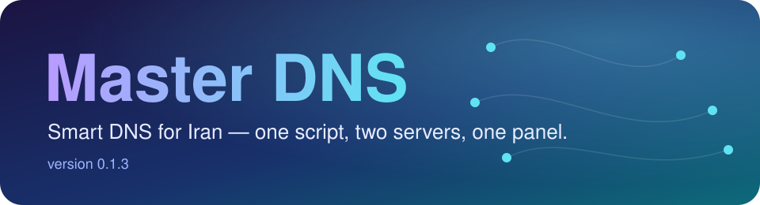
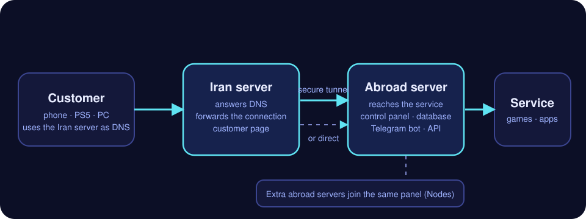
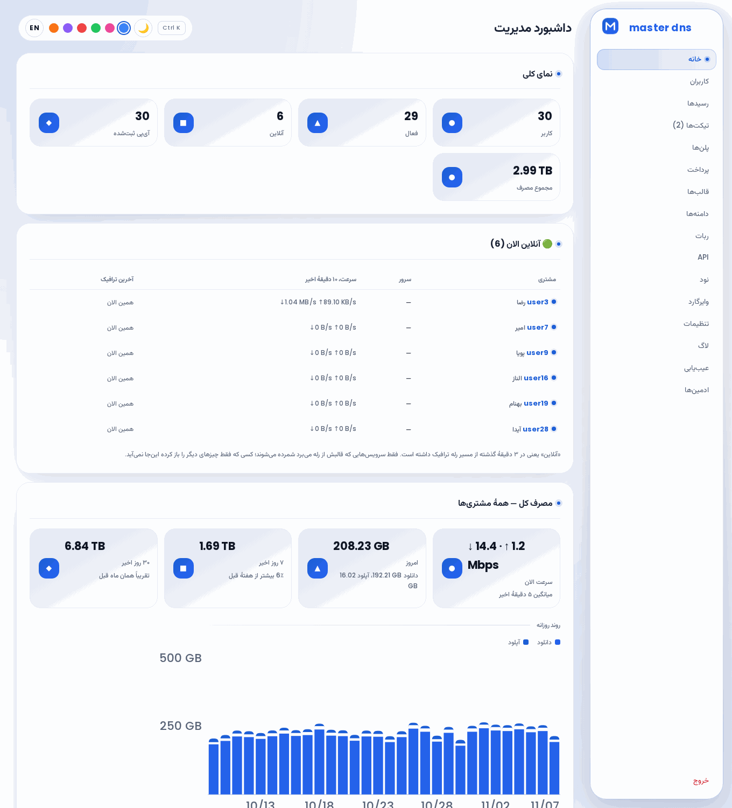
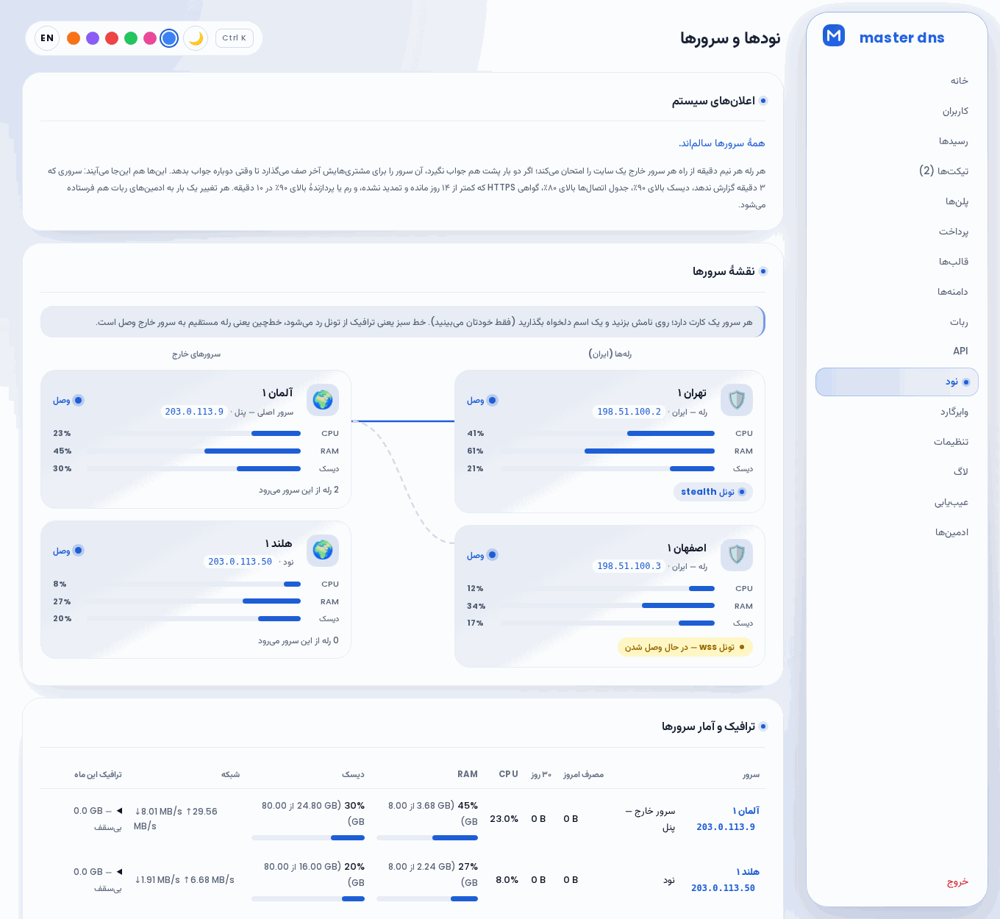
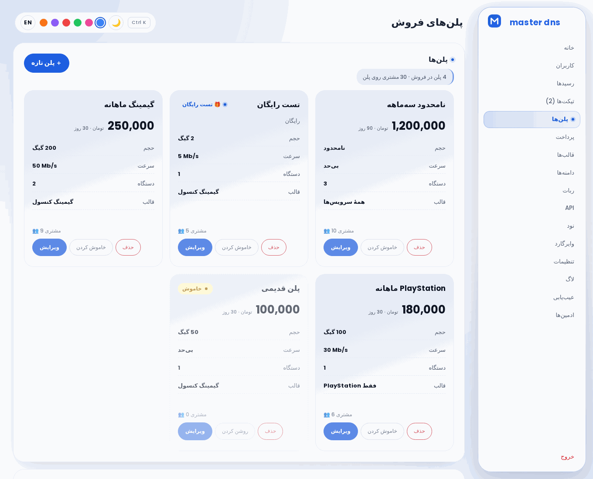
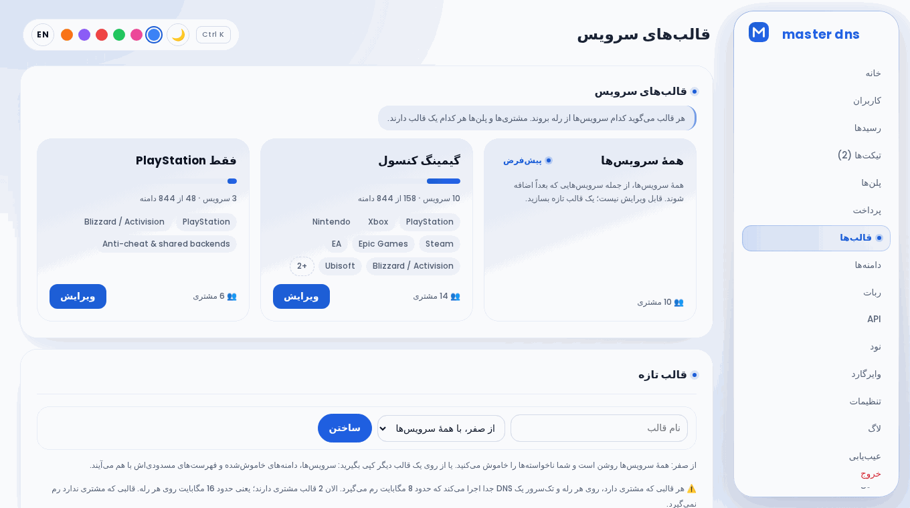
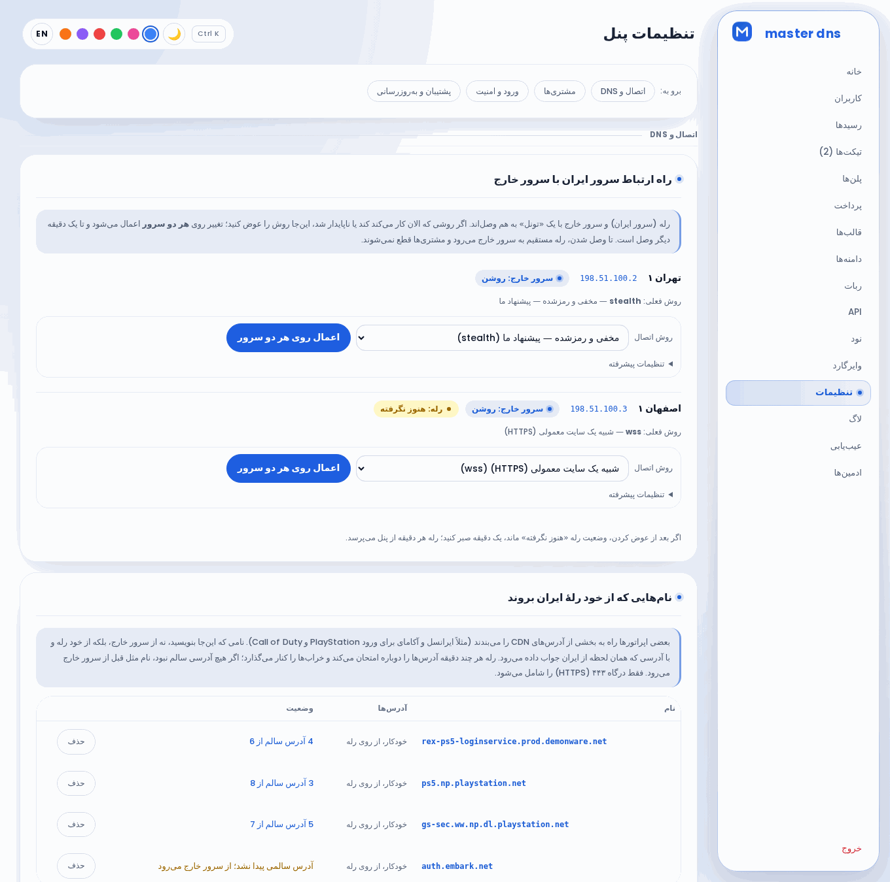
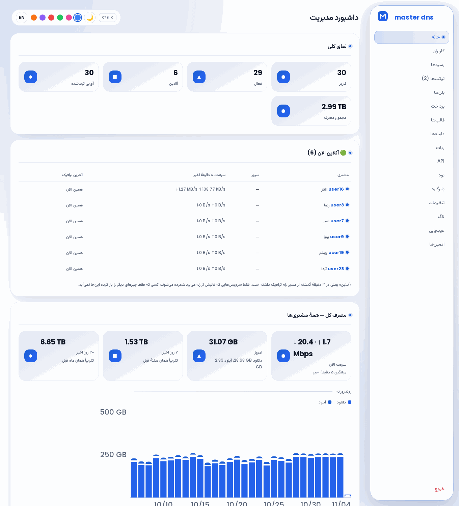
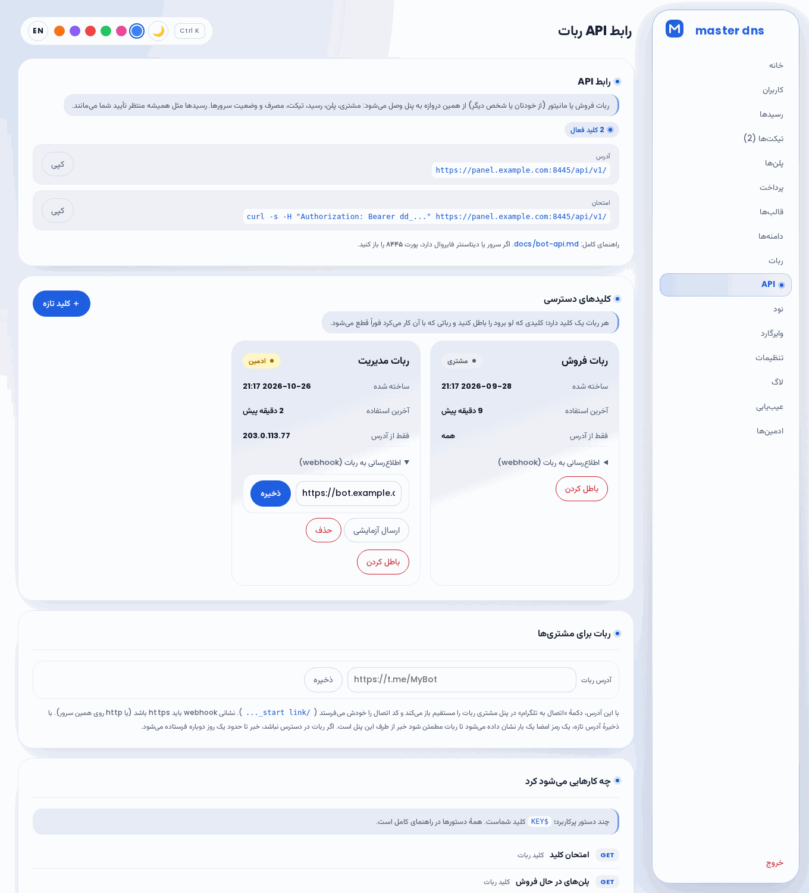
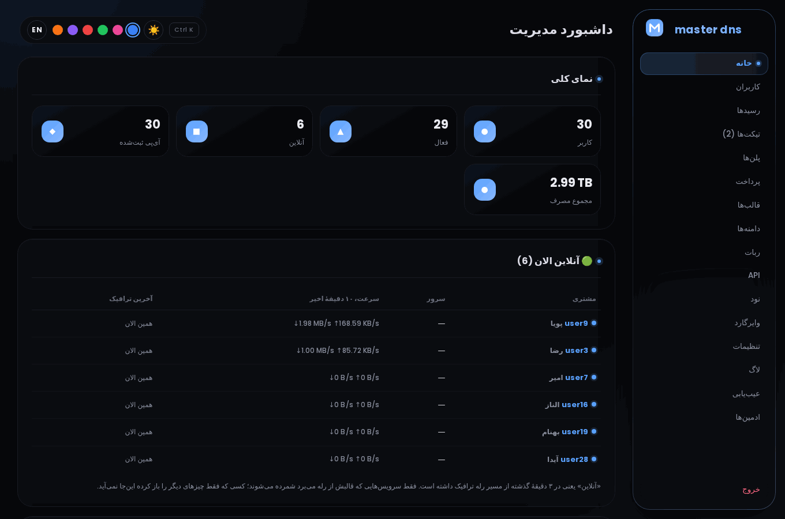

<div align="center" dir="rtl">



**اسمارت DNS برای ایران؛ در یک بعدازظهر راه می‌افتد و قابل‌فروش است.**
یک اسکریپت، دو سرور، یک پنل مدیریت.

*[English](README.md)*

</div>

<div dir="rtl">

---

## چیست

مشتری‌ها در ایران گوشی، کامپیوتر یا کنسولشان را روی **سرور ایرانِ شما** به‌عنوان DNS تنظیم می‌کنند.
برای سایت‌های بسته، آدرس همین سرور داده می‌شود و اتصال دست‌نخورده به **سرور خارجِ شما** می‌رود و آنجا
به سرویس می‌رسد. بقیهٔ سایت‌ها عادی باز می‌شوند. در مسیر چیزی رمزگشایی نمی‌شود: سرور ایران فقط
می‌خواند کدام سایت خواسته شده.

<p align="center"></p>

فقط یک پروکسی نیست؛ یک سرویس کامل است: مشتری با حجم و محدودیت سرعت، پلن و رسید، صفحهٔ مشتری، ربات
تلگرام و API، همه از یک پنل.

<p align="center"> </p>

<details>
<summary><b>بیشتر از پنل</b> (خود پنل، با مشتری‌های ساختگی)</summary>

| | |
|---|---|
| <br><sub>پلن‌ها، با ویرایش در یک پنجره</sub> | <br><sub>قالب‌ها: هر کدام چه چیزی را می‌برد</sub> |
| <br><sub>تونل، و نام‌هایی که از ایران بروند</sub> | <br><sub>مصرف و پیش‌بینی یک مشتری</sub> |
| <br><sub>کلیدهای API و webhook</sub> | <br><sub>تم تیره</sub> |

با `python3 tools/make-screenshots.py` بعد از تغییر ظاهر دوباره گرفته می‌شوند.

</details>

## شروع سریع

```sh
curl -fsSLO https://raw.githubusercontent.com/AlsoAryan/Master-dns/main/master-dns.sh
sudo bash master-dns.sh
```

۱. **روی سرور خارج** «Abroad server» را بزنید. در پایان لینک پنل، نام کاربری، گذرواژه و یک **کد
   اتصال** نشان می‌دهد.
۲. **روی سرور ایران** «Iran server» را بزنید و کد اتصال را بچسبانید.
۳. آدرس IP سرور ایران را به مشتری‌ها بدهید تا DNS خود کنند. بقیه را از پنل مدیریت کنید.

عمداً اول دانلود می‌شود و pipe نمی‌شود: سؤال می‌پرسد، و اگر فایل ناقص دانلود شده باشد اجرا نمی‌شود.

**پورت‌ها.** پنل مدیریت پیش‌فرض روی **9443** است؛ اگر فایروال سر راه است بازش کنید. اگر پورت دیگری
انتخاب می‌کنید نباید یکی از پورت‌های در حال استفاده باشد: 22 (ssh)، 53 (DNS)، 80 و 443 (پروکسی)، 8443 (API همگام‌سازی
که سرورهای ایران به آن وصل می‌شوند)، 8445 (API ربات)، 8446 (مسیر خود سرور خارج به گوگل روی IPv6)، و روی سرور ایران
3478 (STUN). نصب‌کننده آن‌ها را رد می‌کند و دلیلش را می‌گوید.

| انتخاب شما | کجا | کارش |
|---|---|---|
| **Abroad server** | سرور خارج | پنل، دیتابیس، مسیر خروج. اول این را نصب کنید. |
| **Iran server** | سرور ایران | جواب DNS و صفحهٔ مشتری. |
| **One server only** | یک سرور خارج | همهٔ این‌ها روی یک ماشین؛ برای امتحان. |
| **Extra abroad server** | سرور خارج دیگر | یک مسیر خروج اضافه، از صفحهٔ *نودها*. |

## چه می‌کند

- **راه‌اندازی.** حدود ۸۰۰ دامنهٔ تحریمی و ۱۵۰ بازی و پلتفرم، در قالب‌هایی که تیک می‌زنید. چند
  سرور ایران و خروج روی یک پنل، هر کدام با اسم، وضعیت و نقشهٔ زنده. تونل بینشان را از پنل عوض
  کنید. پشتیبان رمزشده، هشدار و ارتقای یک‌دکمه.
- **فروش.** پلن، رسید، کد تخفیف، تست رایگان، کیف پول، لینک دعوت، دستگاه اضافه، و نماینده با پلن و
  ربات خودش. پنل مشتری فارسی یا انگلیسی.
- **دیدن.** مصرف هر مشتری ساعتی و روزانه، پیش‌بینی حجم، ساعت‌های شلوغ شبانه‌روز، و دو گزارش API برای
  ربات خودتان: ترافیک، و اینکه همهٔ سرورها بالا هستند یا نه.
- **کار کردن بازی‌ها.** نام‌هایی که یک شبکه خفه می‌کند از خود ایران می‌روند؛ نام‌هایی که بازی
  مستقیم می‌خواهد مستقیم می‌مانند. [وقتی بازی بالا نمی‌آید](docs/troubleshooting.fa.md) را ببینید.

## تازه‌ترین: ۰.۱.۴

- **سرعت DNS.** ریزالور همزمان از همهٔ ریزالورهای عمومی می‌پرسد و اولین جواب را برمی‌دارد؛ تا ۱۰۰۰ پرسش هم‌زمان می‌پذیرد (به‌جای ۱۵۰)؛ هر جواب را دست‌کم یک دقیقه نگه می‌دارد؛ و اگر dnsmasq نسخهٔ ۲.۸۹ یا بالاتر باشد، جواب منقضی را فوراً می‌دهد و در پس‌زمینه جواب تازه می‌گیرد.
- **پکت‌لاست.** آدرس مشتریِ ثبت‌شده تا ۸۰۰ پرسش DNS در ثانیه می‌فرستد (قبلاً ۴۰)، پس آدرس مشترک اپراتورهای موبایل دیگر اسم گم نمی‌کند؛ nginx روی هر دو طرفِ همهٔ پورت‌ها keepalive می‌خواهد تا اتصالی که NAT موبایل فراموش می‌کند نگه داشته یا زود فهمیده شود؛ و کرنل برای اتصال‌های کم‌ترافیک (بازی، چت) با فاصلهٔ یکنواخت دوباره می‌فرستد.
- **بررسی کاتالوگ.** `python3 tools/audit-catalogue.py` سرویس‌ها، بازی‌ها و قاعده‌های bypass را بدون شبکه می‌خواند و اسم خراب، بازیِ نیازمندِ گروهِ ناموجود و اسم‌هایی را که نباید از رله بروند (EA، Demonware، STUN پلی‌استیشن، ورود راک‌استار) گزارش می‌دهد.

## نسخهٔ قبل: ۰.۱.۳

- **اینترنت موبایل.** جواب‌ها TTL یک دقیقه‌ای دارند (به‌جای صفر) و از ۱۲۳۲ بایت بزرگ‌تر نمی‌شوند؛ پس گوشی نه برای هر اتصال دوباره می‌پرسد و نه جواب تکه‌تکه‌شده را از دست می‌دهد. روی ایرانسل، همراه اول و رایتل که آدرس خودبه‌خود عوض می‌شود، مشتری روزانه سه برابر آدرس تازه می‌تواند ثبت کند (یا عددی که شما بگذارید).
- **گوشی.** صفحهٔ مشتری و پنل ادمین روی صفحهٔ باریک دیگر به پهلو نمی‌زنند؛ اسکریپت عکس‌برداری حالا اگر صفحه‌ای از گوشی پهن‌تر باشد خطا می‌دهد.
- **کاتالوگ.** دامنهٔ خود Claude (`claude.com`)، هوش مصنوعی بیشتر، دو گروه برای هوش مصنوعی تصویر/ویدیو/صدا و ابزارهای ساخت برنامه، چند نام هاستینگ، و Counter-Strike 2 و Dota 2 به‌عنوان بازی.

قبل‌تر: ۰.۱.۲ تست NAT در PS5 و ورود GTA Online را درست کرد و تشخیص پورت‌های بی‌صاحب را به `smartdns-watch` آورد؛ ۰.۱.۱ گزارش‌های ترافیک و وضعیت در API؛ ۰.۱.۰ نام‌هایی که از سرور ایران بروند.

## بیشتر

- [docs/troubleshooting.fa.md](docs/troubleshooting.fa.md): بازی لود می‌شود و می‌ایستد، یا ورودش می‌افتد. هر مورد گزارش‌شده چه بود و چه کاری شده.
- [docs/commands.fa.md](docs/commands.fa.md): همهٔ دستورهای روی سرورها و تنظیمات کرنل که نصب می‌کند.
- [docs/bot-api.md](docs/bot-api.md): API برای ربات فروش یا مانیتور.

```sh
curl -s -H "Authorization: Bearer $KEY" "https://PANEL/api/v1/admin/traffic?days=7"   # چقدر، کی، چه کسی، برای چه
curl -s -H "Authorization: Bearer $KEY" https://PANEL/api/v1/admin/status                # همهٔ سرورها بالا هستند؟
```

## ساخت و تست

فایل `master-dns.sh` ساخته می‌شود، دستی ویرایش نکنید. منطق در `tools/installer-logic.sh` است و کانفیگ‌ها در `templates/`، `common/` و `domains/`.

```sh
python3 tools/build-installer.py   # master-dns.sh را دوباره می‌سازد
bash -n master-dns.sh              # بش معتبر می‌ماند
for t in tools/test-*.py; do python3 "$t"; done
```

## محدودیت‌ها

- فقط دانلود شکل‌دهی می‌شود، آپلود نه.
- ریلی بدون گواهی پنل مشتری ندارد؛ صفحهٔ رمز را روی HTTP ساده نمی‌دهد. دامنه بدهید.
- فقط ثبت‌نام ترافیک نمی‌دهد؛ حساب باید پلن داشته باشد.
- ترافیک دو برابر حساب می‌شود: یک گیگ مشتری حدود دو گیگ روی ریلی و دو گیگ روی اگزیت است.

## سپاس

- **[BackPack](https://github.com/AminMGMT/BackPack)** از **امین محمدی**
  ([@AminMGMT](https://github.com/AminMGMT)) تونل اختیاری بین ریلی و اگزیت را
  می‌رساند. کار خود اوست با مجوز AGPL-3.0: این پروژه فقط انتشارهای دست‌نخوردهٔ
  خودش را دانلود می‌کند، با هش ثابت چک می‌کند و اجرا می‌کند. ممنون امین.
- **[Vazirmatn](https://github.com/rastikerdar/vazirmatn)** از **صابر راستی‌کردار**،
  فونت هر دو پنل است، با مجوز SIL Open Font License 1.1 و همراه مجوزش در نصب‌کننده.
- **[Poppins](https://github.com/itfoundry/Poppins)** از Poppins Project Authors حروف و ارقام لاتین
  هر دو پنل است؛ زیرمجموعهٔ کوچکی از آن داخل صفحه‌ها گذاشته شده. مجوزش SIL Open Font License 1.1 است
  و متن مجوز در `common/fonts/Poppins-OFL.txt` قرار دارد.
- اپراتور هر مشتری در پنل ادمین از [RIPEstat](https://stat.ripe.net/) می‌آید.
- لوگوی سرویس‌ها از **[Simple Icons](https://simpleicons.org/)** (CC0) و آیکن‌های
  ساده از **[Lucide](https://lucide.dev/)** (ISC) است؛ هر لوگو علامت صاحب خودش است.
- **[HyperDNS](https://github.com/IzumiRain/HyperDNS)** از **Rain**
  ([@IzumiRain](https://github.com/IzumiRain))، یک اسمارت DNS مستقل به Go با مجوز
  AGPL-3.0. چند قابلیت از ایده‌های آن شروع شد (DoH و DoT، رسیدهای رمزشده، گزارش
  DNS، جواب خطای ریزالور، دامنه‌های مسدود، نصب تک‌سرور). از کدش چیزی
  برداشته نشد و هر کدام دوباره نوشته شد، ولی ایده‌ها اول از آن‌ها بود. ممنون Rain.
- بررسی نام ثبت‌کنندهٔ آدرس اگزیت از سرویس عمومی RDAP ثبت‌کنندگان اینترنت،
  از راه [rdap.org](https://rdap.org/)، می‌گذرد.
- کانفیگ nginx اگزیت از [rohammosalli/smart-dns](https://github.com/rohammosalli/smart-dns)
  شروع شد.

## مجوز

MIT، فایل [LICENSE](LICENSE). اعلان‌های کپی‌رایتِ کاری که این پروژه از آن رشد کرد
در فایل مجوز می‌ماند.

</div>
