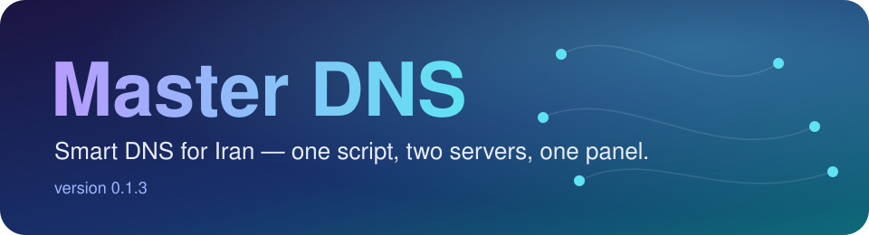
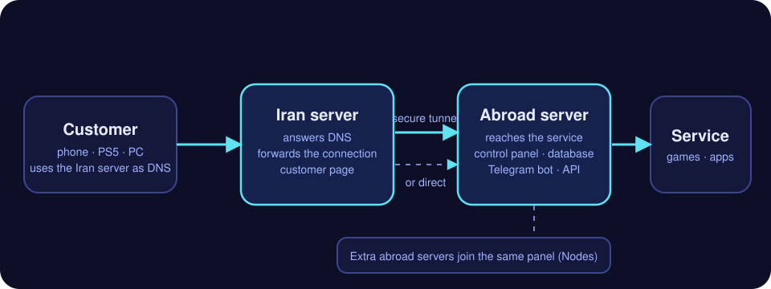
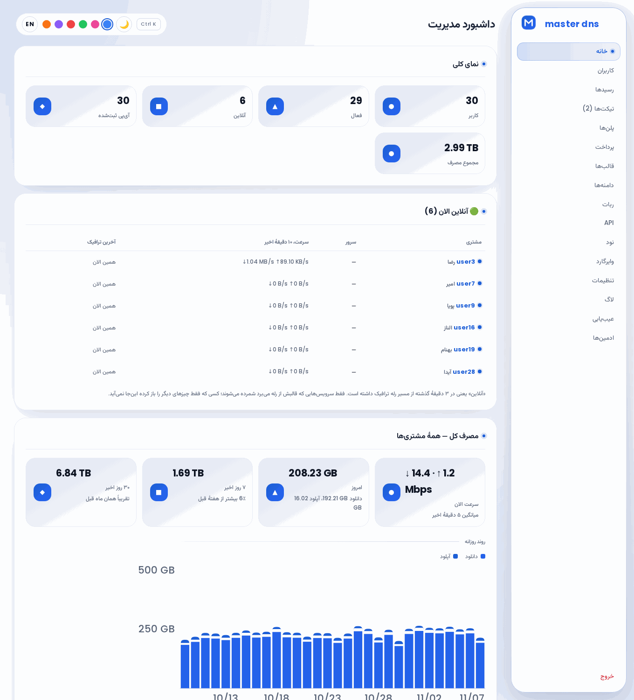
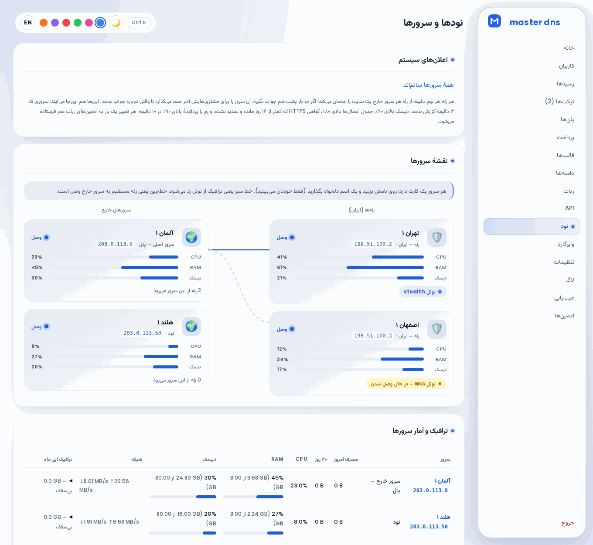
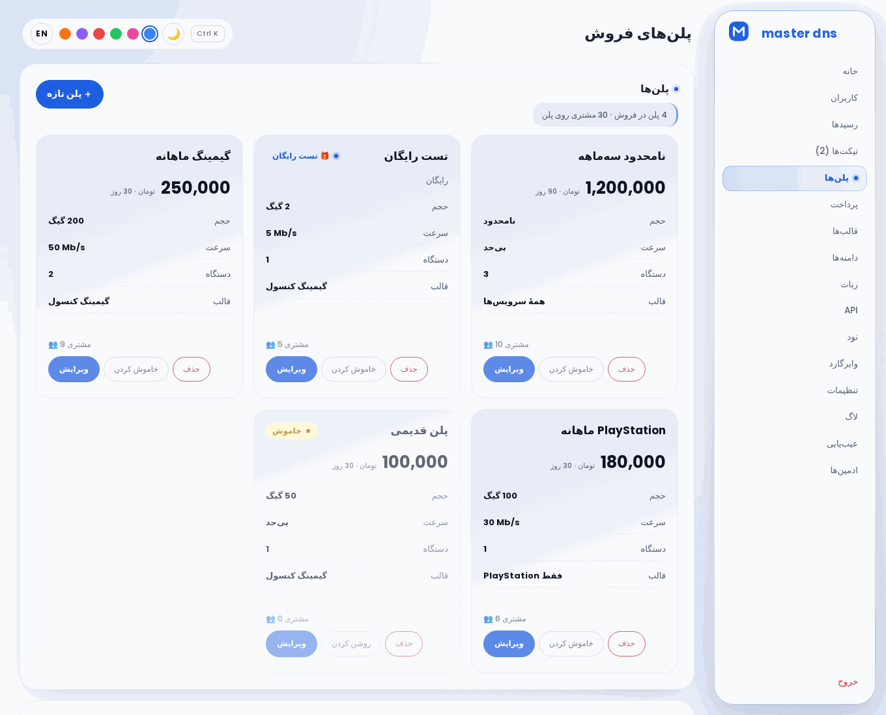
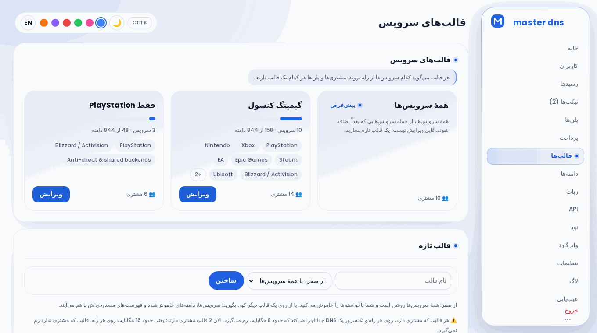
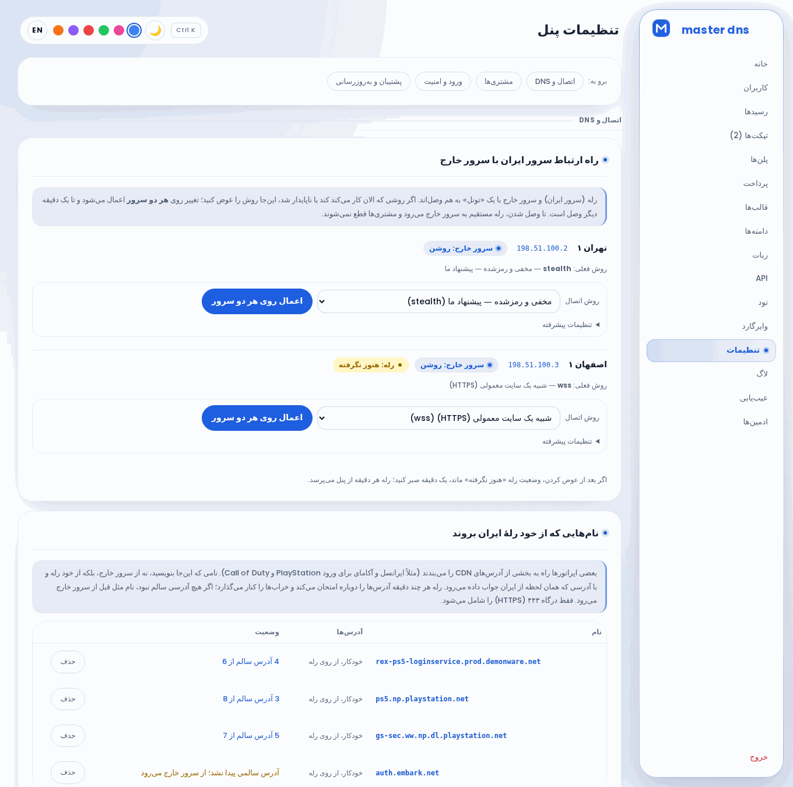
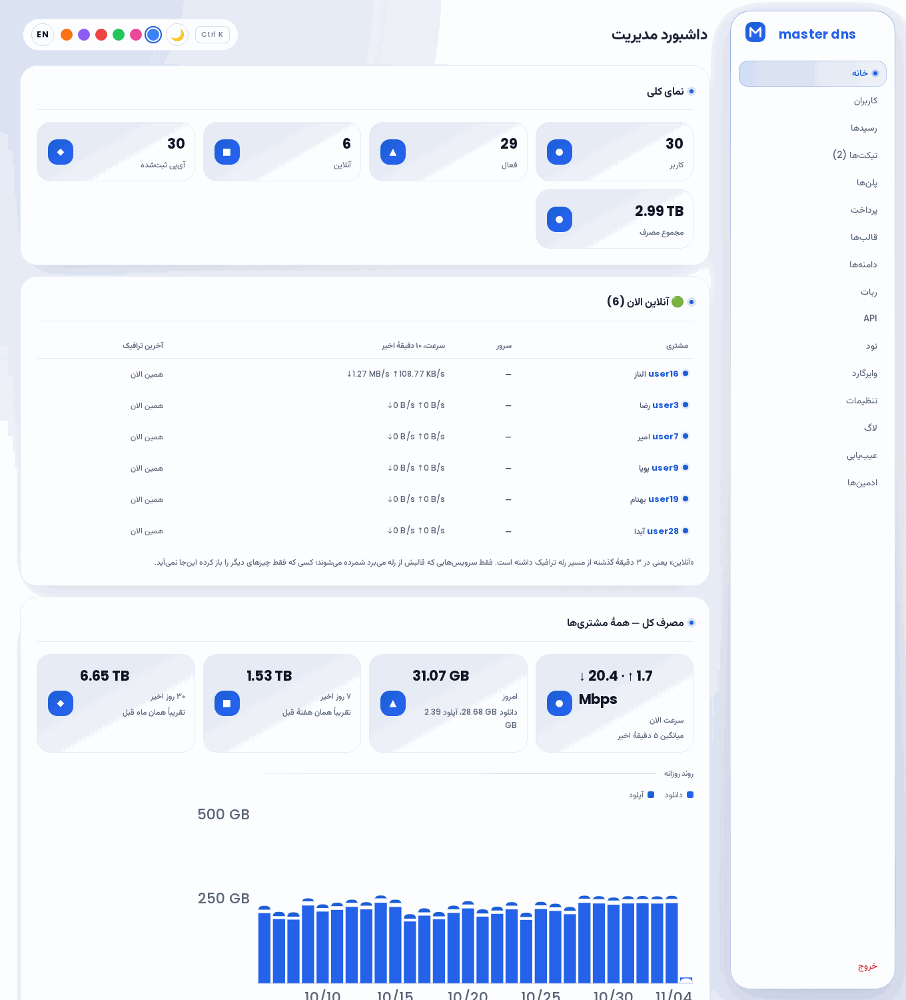
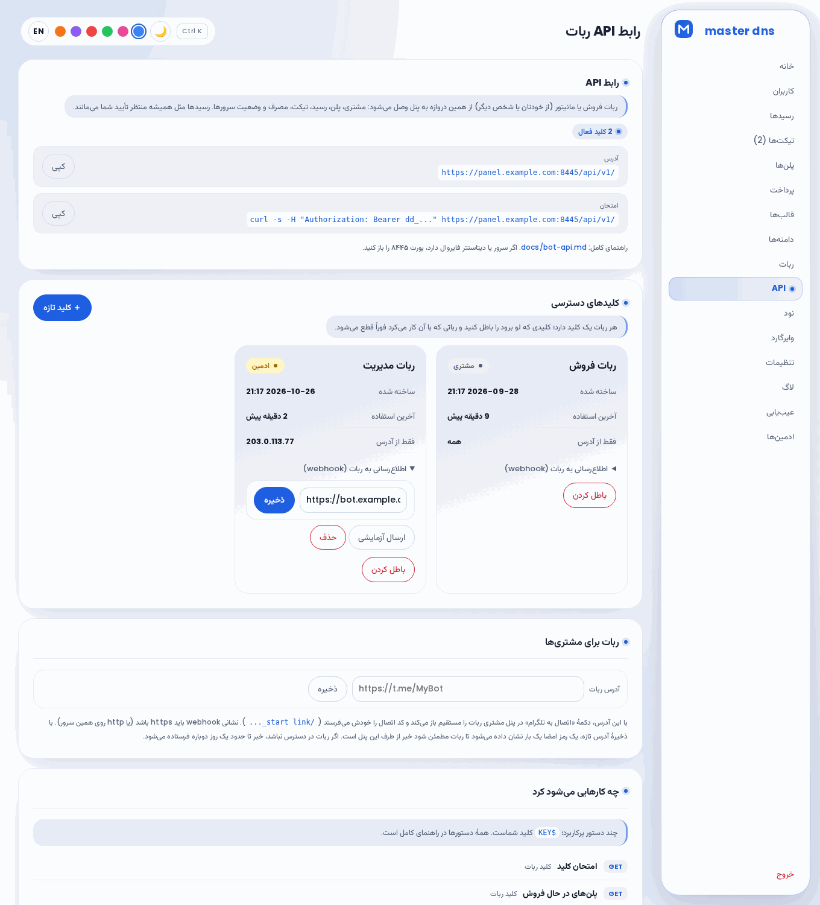
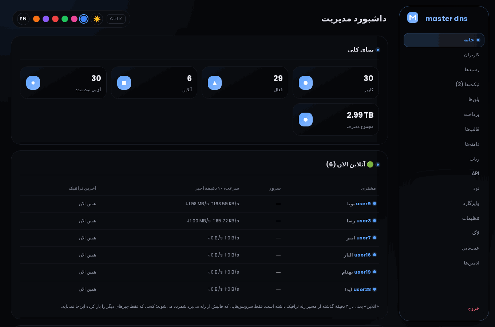

<div align="center">



**Smart DNS for Iran that you can run, and sell, in an afternoon.**
One script, two servers, one control panel.

*[فارسی](README.fa.md)*

</div>

---

## What it is

People in Iran set **your Iran server** as the DNS of their phone, PC or console. For blocked
sites it answers with its own address, and the connection goes on, untouched, to **your server
abroad**, which reaches the service. Everything else loads the normal way. Nothing is decrypted
on the way: the Iran server reads only which site is asked for.

<p align="center"></p>

It is a whole service, not just a proxy: customers with quotas and speed limits, plans and
receipts, a customer page, a Telegram bot and an API, all run from one panel.

<p align="center"> </p>

<details>
<summary><b>More of the panel</b> (the real thing, with invented customers)</summary>

| | |
|---|---|
| <br><sub>Plans, edited in a dialog</sub> | <br><sub>Templates: what each routes</sub> |
| <br><sub>Tunnel, and names carried from Iran</sub> | <br><sub>A customer's usage and forecast</sub> |
| <br><sub>API keys and webhooks</sub> | <br><sub>The dark theme</sub> |

`python3 tools/make-screenshots.py` takes them again after the interface changes.

</details>

## Quick start

```sh
curl -fsSLO https://raw.githubusercontent.com/AlsoAryan/Master-dns/main/master-dns.sh
sudo bash master-dns.sh
```

1. **On the server abroad**, choose *Abroad server*. It ends by printing the control-panel link, your
   username and password, and a **connection code**.
2. **On the server in Iran**, choose *Iran server* and paste the connection code.
3. Give your customers the Iran server's IP address as their DNS. Manage everything from the panel.

It downloads first, not piped, on purpose: it asks questions, and it refuses to run if the file is cut short.

**Ports.** The control panel is on **9443** by default; if a firewall is in the way, open it. If you choose another
port, it must not be one already in use: 22 (ssh), 53 (DNS), 80 and 443 (the proxy), 8443 (the sync API the
Iran servers connect to), 8445 (the bot API), 8446 (the abroad server's own route to Google over IPv6), and on an
Iran server 3478 (STUN). The installer refuses those and says why.

| You choose | Where | What it does |
|---|---|---|
| **Abroad server** | a server abroad | The panel, the database, the way out. Install it first. |
| **Iran server** | a server in Iran | Answers DNS and serves the customer page. |
| **One server only** | one server abroad | All of it on one machine; for trying it out. |
| **Extra abroad server** | another server abroad | One more way out, added from the *Nodes* page. |

## What it does

- **Run it.** About 800 blocked domains and 150 games and platforms, kept in templates you tick.
  Several Iran servers and exits on one panel, each named, with health and a live map. Change the
  tunnel between them from the panel. Encrypted backups, alerts, one-button upgrades.
- **Sell it.** Plans, receipts, discount codes, a free trial, a wallet, invitation links, extra
  devices, and resellers with their own plans and bot. Customers get a panel in Persian or English.
- **Watch it.** Per-customer traffic by the hour and day, quota forecasts, busy hours of the day,
  and two API reports for your own bot: traffic, and whether every server is up.
- **Keep games working.** Names a network chokes are carried from Iran itself; names a game needs
  direct are kept direct. See [when a game will not start](docs/troubleshooting.md).

## Latest: 0.1.4

- **DNS speed.** The resolver asks every public resolver at once and takes the first answer, allows 1000 queries in flight instead of 150, keeps any answer at least a minute, and, where dnsmasq is 2.89 or newer, serves an expired answer at once while it fetches a fresh one.
- **Packet loss.** A registered customer's address may send 800 DNS queries a second instead of 40, so a mobile operator's shared address no longer loses names; nginx asks for TCP keepalives on both sides of every stream port, so a connection a mobile NAT would forget is kept or noticed; the kernel retries thin streams (games, chat) at an even pace and probes idle connections after a minute.
- **Checking the catalogue.** `python3 tools/audit-catalogue.py` reads the services, games and bypass rules offline and reports bad names, games that need a missing group, and names that must never be routed (EA, Demonware, PlayStation STUN, Rockstar sign-in).

## Before: 0.1.3

- **Mobile data.** Answers carry a one-minute TTL instead of zero and never exceed 1232 bytes, so a phone neither asks again for every connection nor loses fragmented replies. On Irancell, MCI (Hamrah-e Avval) and Rightel, where the address changes by itself, a customer may register three times as many new addresses a day (or a number you set).
- **Phones.** The customer page and the admin panel no longer spill sideways on a narrow screen; the screenshot script now fails if any page is wider than a phone.
- **Catalogue.** Claude's own domain (`claude.com`), more AI, two groups for image/video/voice AI and for AI app builders, a few hosting names, and Counter-Strike 2 and Dota 2 as games.

Earlier: 0.1.2 fixed the PS5 NAT test and GTA Online login and added stranded-port detection to `smartdns-watch`; 0.1.1 added the traffic and status API reports; 0.1.0 added names carried from the Iran server.

## More

- [docs/troubleshooting.md](docs/troubleshooting.md): a game loads and stops, or its login fails. What each reported case was, and what is already done.
- [docs/commands.md](docs/commands.md): every command on the servers, and the kernel settings the install makes.
- [docs/bot-api.md](docs/bot-api.md): the API for a sales or monitoring bot (Persian).

```sh
curl -s -H "Authorization: Bearer $KEY" "https://PANEL/api/v1/admin/traffic?days=7"   # how much, when, who, for what
curl -s -H "Authorization: Bearer $KEY" https://PANEL/api/v1/admin/status                # is every server up?
```

## Build and test

`master-dns.sh` is generated: the logic is in `tools/installer-logic.sh`, the configs in `templates/`, `common/` and `domains/`.

```sh
python3 tools/build-installer.py   # rewrites master-dns.sh
bash -n master-dns.sh              # it stays valid bash
for t in tools/test-*.py; do python3 "$t"; done
```

## Known limits

- Only download is shaped, not upload.
- A relay without a certificate has no customer panel; it will not serve a password page over plain HTTP. Give it a domain.
- Sign-up alone gives no traffic; the account needs a plan.
- Traffic costs double: a customer's gigabyte is about two on the relay and two on the exit.

## Credits

- **[BackPack](https://github.com/AminMGMT/BackPack)**, by **Amin Mohammadi**
  ([@AminMGMT](https://github.com/AminMGMT)), carries the optional tunnel
  between the relay and the exit. It is his work, released under the AGPL-3.0:
  this project only downloads his own unmodified releases, checks them against
  a pinned hash, and runs them. Thank you, Amin.
- **[Vazirmatn](https://github.com/rastikerdar/vazirmatn)**, by **Saber Rastikerdar**,
  is the font of both panels. It is released under the SIL Open Font License 1.1
  and travels inside the installer with its licence. With thanks to him and the
  Vazirmatn project.
- **[Poppins](https://github.com/itfoundry/Poppins)**, by the Poppins Project Authors,
  sets the Latin letters and numerals in both panels; a small subset is embedded in
  the pages. It is released under the SIL Open Font License 1.1, and its licence is
  in `common/fonts/Poppins-OFL.txt`.
- The operator shown for each customer in the admin panel comes from
  [RIPEstat](https://stat.ripe.net/), RIPE NCC's public routing data.
- The services' logos on a template's page are from **[Simple Icons](https://simpleicons.org/)**
  (CC0), and the plain icons for rows that are no brand from **[Lucide](https://lucide.dev/)**
  (ISC). Each logo is its owner's trademark.
- **[HyperDNS](https://github.com/IzumiRain/HyperDNS)**, by **Rain**
  ([@IzumiRain](https://github.com/IzumiRain)), a standalone smart DNS written in Go
  and released under the AGPL-3.0. Reading it showed us what was
  missing here, and several features began as its ideas: DNS over HTTPS and over
  TLS, with the customer usage dashboard and the choice of public resolvers planned
  beside them (0.7.0); the sealed, encrypted receipts (0.7.2); the DNS report that
  says which rule each name met (0.7.3); an answer that says the resolver failed,
  rather than silence (0.7.4); blocked domains and the single-server install (0.8.0);
  the services' logos, and groups of your own domains with an icon (0.9.10).
  None of its code was used - each was written here, in Python, for this
  design - but the ideas were theirs first. Thank you, Rain.
- The installer's check of whose name an exit's address is registered in asks the
  regional internet registries' public RDAP service, through [rdap.org](https://rdap.org/).
- The exit's nginx configuration started from
  [rohammosalli/smart-dns](https://github.com/rohammosalli/smart-dns).

## Licence

MIT, see [LICENSE](LICENSE). The copyright notices of the work this project grew
from stay in the licence file.
