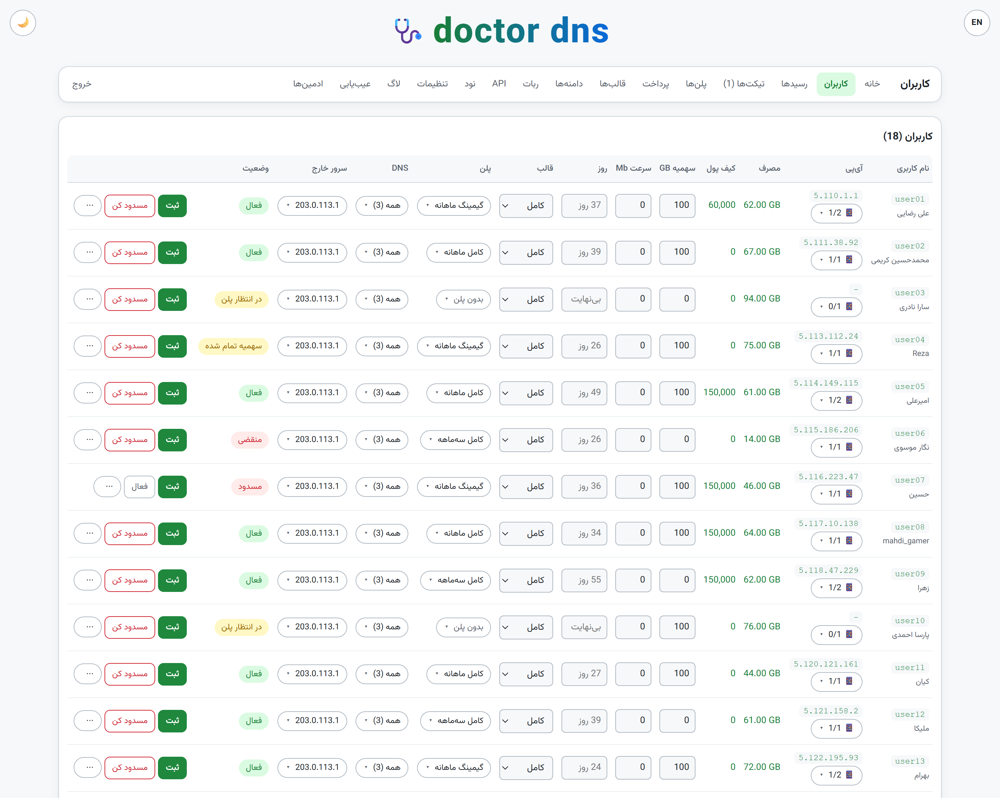
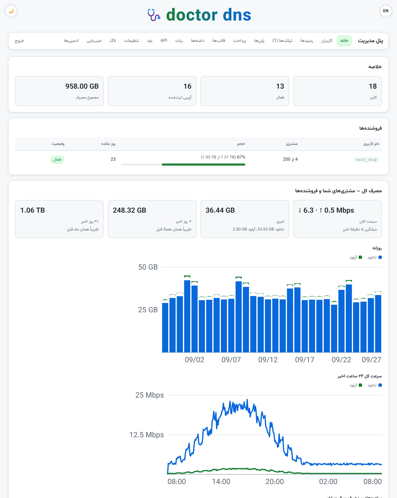
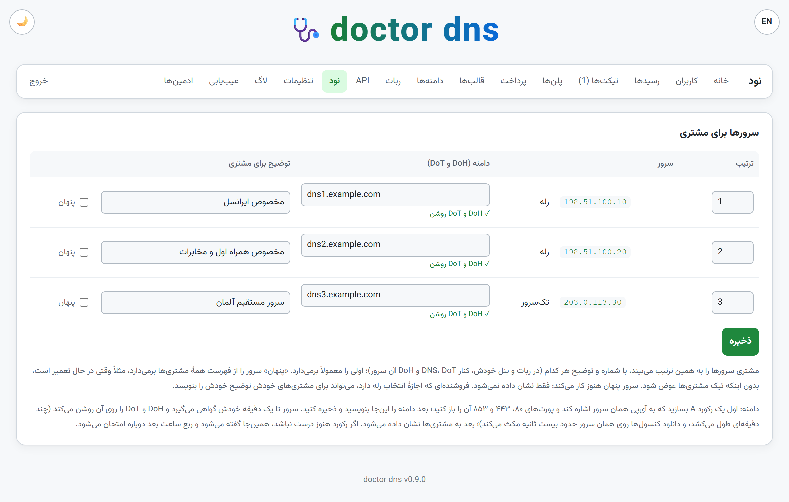
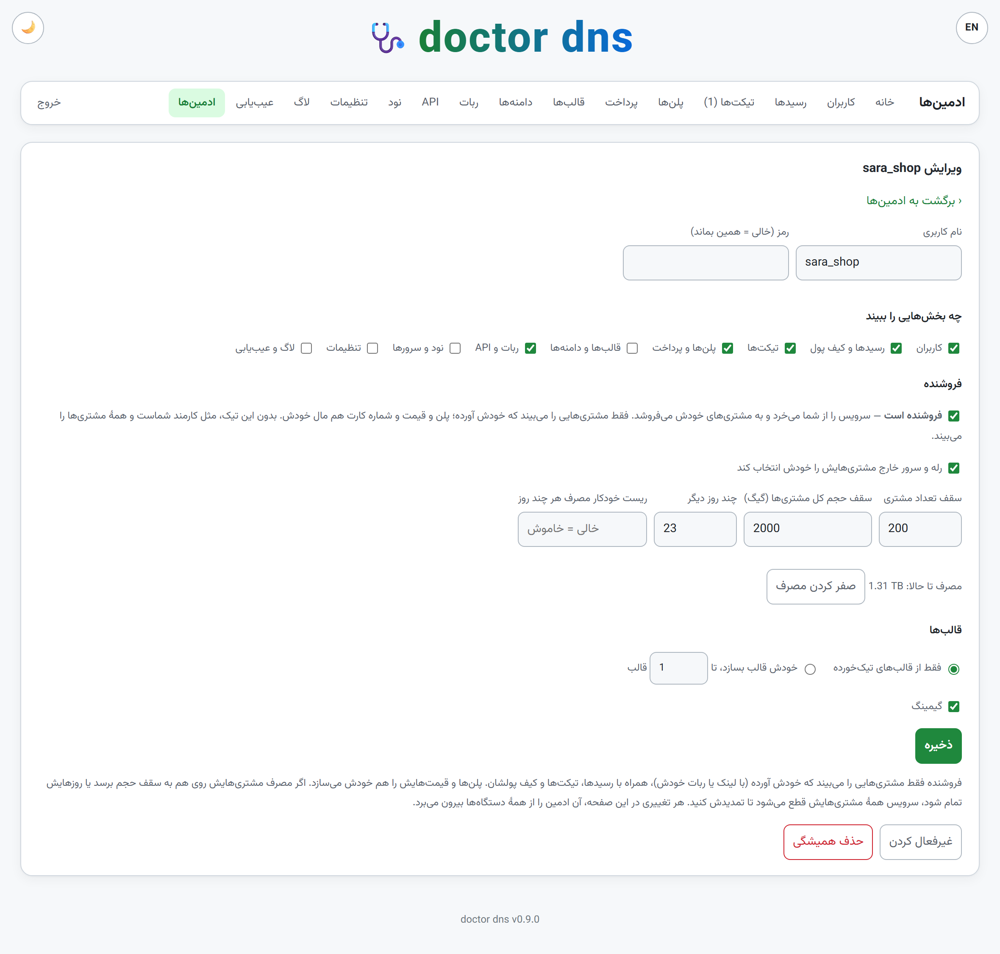
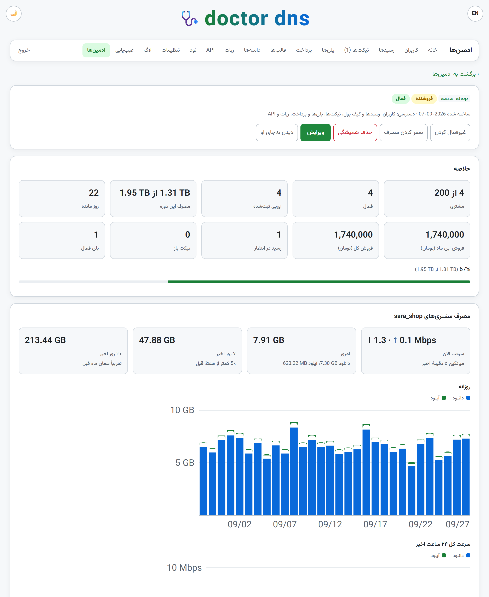
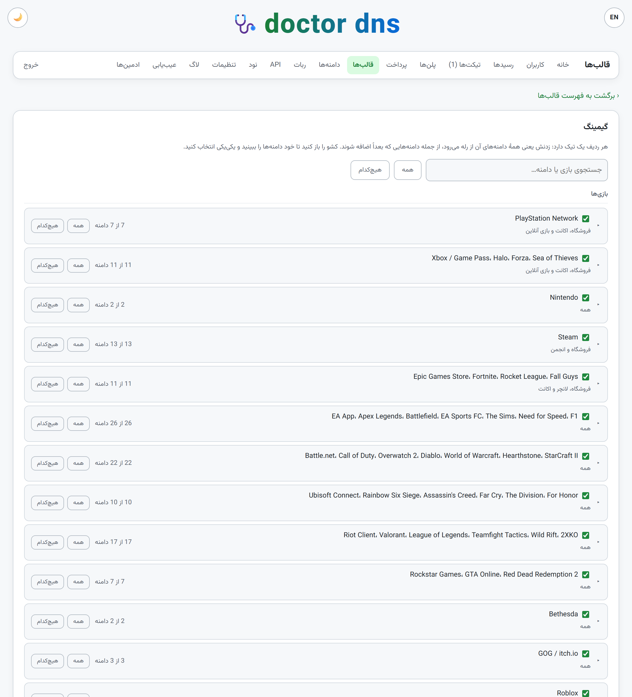
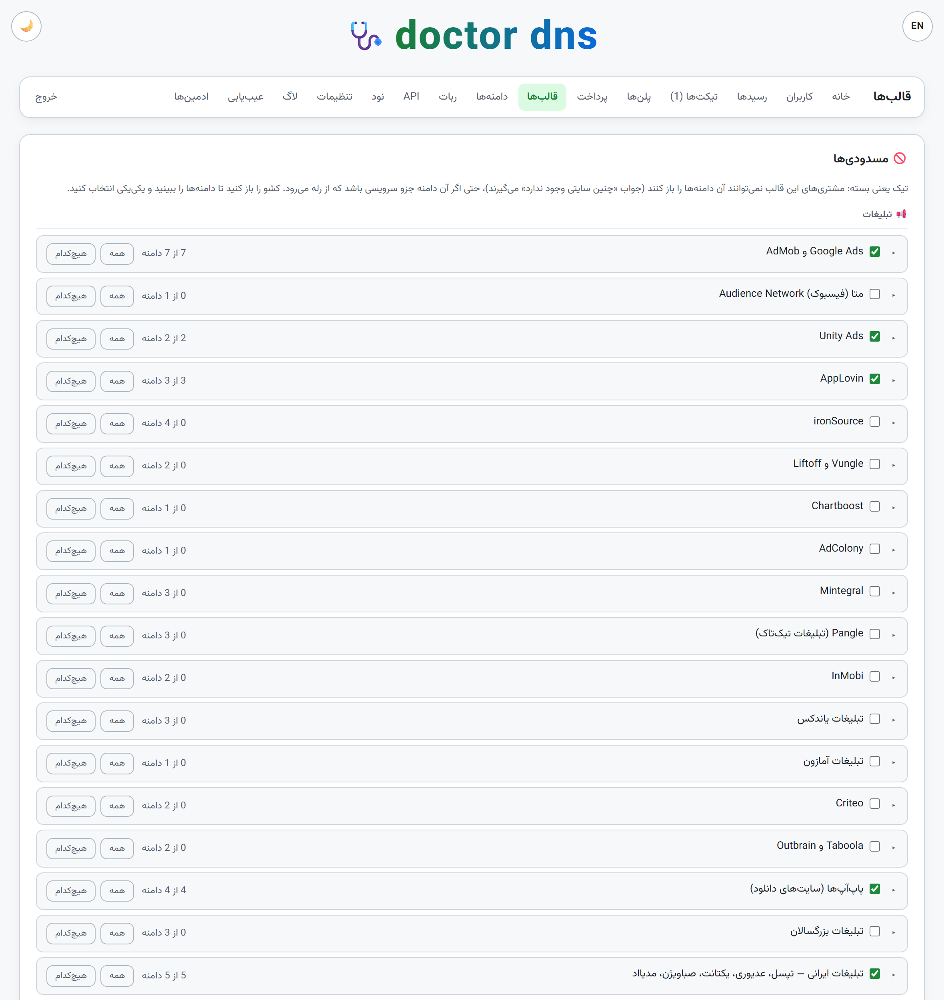
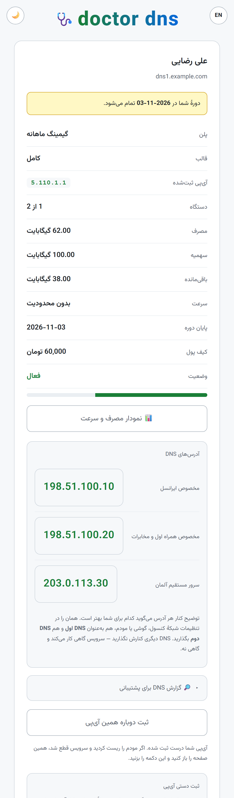

# master dns

> Master DNS is a fork of Doctor DNS (MIT) — see [LICENSE](LICENSE).

*[فارسی](README.fa.md)*

A smart DNS service for Iran, in two halves: a relay inside the country and an
exit node outside it. Sanctioned domains resolve to the relay, which carries
those connections abroad; everything else resolves normally and goes direct.

It is a whole service, not just a proxy — per-customer access control, traffic
accounting, quotas, speed limits, a customer panel and an operator panel, all
in one install script with no dependencies beyond what Debian ships.

**Alpha.** Help us carry this project forward with your bug reports.

They are worth more than anything else right now. If something breaks, or a
service you expected to work does not,
[open an issue](https://github.com/AlsoAryan/Master-dns/issues) — say which
side it was, what you ran, and what happened. A report of one console failing
one download is a genuinely useful thing; most of what is in here was learnt
exactly that way.

---

## What it does

```
   customer            relay (Iran)              exit (abroad)          service
  ┌────────┐          ┌────────────┐            ┌───────────┐        ┌─────────┐
  │ PS5    │   DNS    │ dnsmasq    │            │           │        │ Sony    │
  │ phone  │ ───────► │  answers   │            │  nginx    │        │ Spotify │
  │ PC     │          │  with self │            │  reads    │        │ …       │
  │        │   TLS    │ nginx      │ ─────────► │  the SNI  │ ─────► │         │
  └────────┘ ───────► │  SNI proxy │            │           │        └─────────┘
                      │ nftables   │            └───────────┘
                      │  gate +    │
                      │  counters  │
                      └────────────┘
```

The relay never terminates TLS. nginx reads the SNI from the handshake and
opens a plain TCP tunnel to the exit, which does the same and connects to the
real host. Nothing decrypts anything, and no certificate is presented to the
client.

Port 80 is forwarded rather than redirected, because Sony and Microsoft serve
game packages over plain HTTP from Akamai edges that answer 443 with a
certificate naming no console host at all.

## What is in it

| | |
|---|---|
| **Routing** | dnsmasq hijacks a list of ~480 sanctioned domains; AAAA answers are filtered so clients cannot route around the proxy |
| **Games** | PlayStation, Xbox and Steam storefronts and downloads; EA, Epic; STUN/TURN on the relay so console NAT detection still works |
| **Access control** | an nftables allowlist keyed on the customer's address, with per-address byte counters in the kernel |
| **Quotas** | monthly or one-off, with warnings at 80% and 95% and automatic cutoff |
| **Speed limits** | a per-customer download cap, shaped with htb + fq_codel rather than by dropping packets |
| **Service templates** | which brands a customer's plan routes, down to individual domains; a few groups ship visible but unticked, because routing them breaks the thing they belong to |
| **Selling** | a plan is a template for some days with an allowance, a price and a number of devices; the customer picks one and sends the slip, and approving it puts the plan on; renewals, a free trial once per Telegram account, discount codes, extra devices bought on top of a plan, and a daily limit on new addresses |
| **Wallet and invitations** | customers top up a wallet by receipt and buy from it at once, with no slip; each has an invitation link, and a share of what the people they bring pay goes into their wallet - the percent, and whether every purchase or only the first, the operator's to set |
| **Sellers** | an admin who buys the service from you and sells it on: only the customers who came by their own link or bot, their own plans, prices and card number, their own Telegram bot, the templates you allow; a cap on customers, traffic and days - past it, all their customers stop; disabled or deleted with everything of theirs in one button; a page of their own stats |
| **Admins** | the owner signs in with a username chosen at install; other admins see only the parts ticked for them, and the owner can see the panel as any of them sees it |
| **Customer panel** | sign up, register an address, see usage and the days left, buy a plan and send the slip, the wallet and the invitation link, each server's DNS, DoT and DoH with the operator's note, tickets, link Telegram and reset a forgotten password with a Telegram code |
| **Encrypted DNS** | each relay and single server has its own DNS over HTTPS on 443 and DNS over TLS on 853 - its domain given at install, or later from the admin panel, which gets the certificate by itself - a personal address for each customer on each server, an iPhone profile and a Windows 11 command for each; like plain DNS it answers only a registered address |
| **Servers for customers** | the order customers see the servers in, a note beside each ("for Irancell"), and hiding one from everybody while it is repaired; which servers each customer is shown, ticked per customer; and which servers each plan works on, ticked per plan - its customers get no service on the others |
| **The panel comes up by itself** | an address not registered, or out of volume or days, that uses our DNS: its phone or console shows "sign in to network" and the customer panel opens - over plain DNS, DoT and DoH; any `http://` site shows it too |
| **Usage dashboard** | the customer's speed now, 7 and 30 days against the period before, when the allowance runs out, daily download and upload, 24 hours of speed, busy hours, a connection check, and usage by service — kept as service, day and bytes for 30 days, never as a list of sites; the operator sees the same charts without the services |
| **Upstream DNS** | the operator picks the public resolvers — Cloudflare, Quad9, Google, OpenDNS, AdGuard or any address — and each relay tests the pick from Iran before it takes it |
| **Operator panel** | customers, plans, receipts, tickets, templates, domains, host monitoring, backup and restore; everybody's usage with each seller's share, and the owner's own customers' apart |
| **More servers** | more exits (nodes) that relays go out through, single servers in other countries on the same panel, customers and allowance shared by all; a standby node that keeps the latest backup and takes the panel over the day its machine is gone |
| **Block lists** | ad networks (Iranian ones among them) and adult sites, closed per template row by row, or StevenBlack's full lists updated weekly |
| **Public DNS** | one button that opens every relay to everyone, with no sign-up, and closes it again |
| **Upgrades** | from GitHub with one button: the installer is checked against the hash GitHub published, this server is upgraded first, then every relay, node and single server one by one |
| **Monitoring and backups** | alerts for a server gone quiet, a full disk or connection table, a certificate not renewed, high memory or processor; a monthly traffic cap per server; an encrypted backup of the whole panel sent by the bot |
| **Usage resets** | a customer's or a seller's usage back to zero every so many days, whatever the plan |
| **Telegram bot** | a ready bot for customers (buy, send the slip, register an address in one tap, the wallet, the invitation link, every server's DNS, DoT and DoH, tickets) and for the operator (approve a receipt with one button, answer tickets, a daily report, a message to many customers at once, with photos and videos); a channel customers must join first; set up from the admin panel; a seller sets up their own |
| **WireGuard** | beside the DNS, for where DNS does not work: one config per relay, as a QR in the bot and on the customer's page; only the service's own sites go through it, the rest of the phone's internet goes direct, so it is not a VPN; by default a config works only from the customer's registered addresses; off until the admin turns it on |
| **English** | the admin panel, the customer's page and the bot, in Persian or English |
| **API** | to plug in a sales bot of your own: [docs/bot-api.md](docs/bot-api.md) (in Persian) |
| **TLS** | certificates obtained and renewed automatically, asking for nothing but a domain name |

## What it looks like

The operator's panel, on the exit. Customers, what each has used, their
wallet, quota, speed, days, template, plan, DNS servers and exit — all
editable in the row:



The home page: the sellers and how far into their traffic and days they are,
and every customer's usage together:



Servers for customers: the order they are shown in, a domain given from the
panel for each one's DoH and DoT, a note the customer sees beside it, and a
way to hide one from everybody for a while:



A seller: their own customers, plans and card number, with a cap on how many
customers, how much traffic and how many days:



And a seller's own page, opened from their name: their customers, traffic,
days and sales, and their customers' usage:



A template decides which brands a customer's plan carries. Open a service and
the domains inside it can be picked one at a time. Each row carries its
service's logo, and your own domains can be put in groups on the Domains page -
a name and an icon of your own, SVG or PNG - each a row of its own in the
templates with one tick; deleting a group deletes its domains too:



And at its foot, ad networks and adult sites, closed row by row:



The customer's own page, served by the relay. What is left, and each of their
servers' DNS address with the operator's note beside it:



*(Made-up customers, documentation addresses and example.com names. Nothing
in these pictures is real.)*

## Install

One script, run once on each machine. It asks which side it is on and the
address of the other.

```sh
curl -fsSLO https://raw.githubusercontent.com/AlsoAryan/Master-dns/main/master-dns.sh && sudo bash master-dns.sh
```

It downloads rather than pipes on purpose. Every config this installs is
stored inside the script itself, below `exit 0`, so it has to be able to read
its own file — and it asks questions, which a pipe would answer with
end-of-file. Downloading also leaves you a copy to read, to re-run, and to
uninstall from. It refuses to run if that copy is not whole.

Run the **exit** first: it prints a pairing token that the relay asks for.

Safe to re-run — configs are backed up, and a step that would change nothing
does nothing. `sudo bash master-dns.sh --uninstall` puts the machine back,
undoing only what this script did.

Uninstall asks two things. First, whether the database (customers, plans,
admins, settings) goes too: kept, a reinstall on the same server brings it all
back; deleted, a last copy stays in `/var/backups/smart-dns` and the next
install starts from nothing. Then it names the packages - nginx, dnsmasq,
coturn, certbot - and asks whether they go too, with their config. python3,
curl, openssl, nftables and the certificates in `/etc/letsencrypt` are never
removed. Without the questions:
`sudo DELETE_DB=1 PURGE_PACKAGES=1 bash master-dns.sh --uninstall`.

### On one server (single)

Choose **3) single** at the first question, or run
`sudo ROLE=single bash master-dns.sh`. The relay, the exit and the panels all
go on one server abroad: no pairing token, no tunnel, and no second machine to
keep running. Give it a domain when it asks, as a relay would want - the
customer panel, DoH and DoT need its certificate.

⚠️ **The trade is the direct path.** Customers in Iran reach this server
straight from their own ISP, and that path - Iran to a server abroad - is
exactly what gets filtered and slowed; a relay inside Iran exists so customers
never take it. A single server is for trying the service out, or for a server
whose direct path from Iran happens to be good. The installer says so too.

Open these in the firewall (on a cloud provider, in its own firewall as well):

| | |
|---|---|
| **tcp** | 22, 53, 80, 443, 853, 1119, 4070, 8443, and the admin panel's port (9443 by default) |
| **udp** | 53, 3478 |

The sync API, which a two-server exit answers on 8443, is on **8449** here and
on loopback only: its only relay is itself. Do not open it. On a cloud machine
behind NAT - the public address not on any interface, as on AWS - the installer
notices and listens on the private address it is mapped to; nothing to set.

### More servers: nodes, single servers, a standby

All of it from the admin panel's **Nodes** page. Each card there has its
own add form and, under it, the command to run on the new machine with the
file of this same version:

- **A node** - another exit. Add its address, run the command on it, and
  once it says "connected" pick the relays that go out through it. A relay
  goes through the exit picked for it and falls back to the others by itself
  when that one does not answer; each relay can have its own tunnel to each
  node.
- **A single server in another country** - relay and exit at once, joined
  to this panel: `ROLE=single PANEL_IP=<main exit> SYNC_TOKEN=<token>`, the
  token from the same card. Its customers, their allowance and every setting
  are this panel's; what is used on it comes off the same allowance.
- **A new relay** - its address on the relays card, then the installer on
  it with the pairing token shown there.
- **A standby** - pick a node. Every six hours it takes the panel's latest
  backup (encrypted with the backup password set in *Settings*) and the
  installer, and every relay and node knows where it is. The day this
  machine is gone: point the admin panel's domain at the standby and run
  `sudo bash /var/lib/smart-dns/standby/master-dns.sh --take-over` there. The
  relays and nodes find the new panel within a minute.

**Servers for customers**, on the same page: the order customers see the
servers in, a note beside each, hiding one from everybody, and a **domain**
for each relay or single server. Make an A record pointing at that server,
open its ports 80, 443 and 853, write the domain there and save: within a
minute the server gets a certificate by itself and turns DoH and DoT on for
it, and customers are shown them beside that server's DNS. If the record is
not right yet it says so there, and tries again a quarter of an hour later.

A server with a domain also shows the customer panel on it. To keep the
panel off some relays, untick that server's **Customer panel**: whoever opens
it is sent to another server's panel, and its DoH and DoT work as before. At
least one server keeps its panel.

### Upgrading

Download the new file and run it. Before it touches anything it compares its
own version against what the machine has, says which way it is going, and
waits for an answer:

```
Version

    installed on this machine:  0.1.0
    this file:                  0.2.0

    this will upgrade this machine from 0.1.0 to 0.2.0.
    your customers, settings, certificates and allowlist are kept.

  go ahead? [y]:
```

The case worth having it for is the other one. Run an old file over a newer
install — a download still sitting in a home directory, months later — and it
says so, and the default answer becomes no.

Your customers, their usage, the sync secret, the panel password and any
certificate all live outside the files the script writes, so an upgrade keeps
them. A copy of the database is taken into `/var/backups/smart-dns/` first
anyway, with `VACUUM INTO` rather than `cp`, because the panel keeps a
write-ahead log beside the database and copying the file alone can miss its
newest rows. `--version` prints what a file is without installing anything,
and `ASSUME_YES=1` takes the default — yes for an upgrade, no for a
downgrade — for anyone scripting it.

**From 0.9.0 the admin panel asks for a username** as well as the password.
A new install asks for it beside the password. On an upgrade from an earlier
version the installer asks for it once - or, with `ASSUME_YES=1`, sets
`admin` - and shows it at the end. Change it on the settings page or with
`smartdns-access username <name>`.

After that, upgrading is one button: **Settings -> New version from GitHub**
checks GitHub every twelve hours. The button downloads the installer from the
release itself, installs it only when its hash is the one GitHub published,
upgrades this server first and then every relay, node and single server one
by one, and stops - and says so - if one fails or does not answer in twenty
minutes. An older version is never installed.

Customers' receipts and ticket pictures are kept sealed, with a key in
`/etc/smart-dns/db.key` on the exit — not in the database, so neither is a
backup of it. **Keep that file** somewhere apart from your backups (the admin
panel's settings page has a button to download it): restoring onto another
machine needs it too, and without it the pictures do not come back, though
everything else does.

### Requirements

Two machines with Debian or Ubuntu and a public address each:

- **relay** — inside Iran, the address customers point their DNS at
- **exit** — outside, reachable from the relay

No pip, no npm, no containers. Python's standard library, nginx, dnsmasq,
nftables and coturn, all from the distribution.

### ⚠️Choosing servers⚠️ - ⚠️what we have measured⚠️

How fast the service is, and whether it works at all, depends less on this
script than on the path between the Iran server and the exit. Iran's filtering
does not treat every foreign server alike: some it leaves alone, some it slows
down, and some it effectively shuts off. The results below come from our own
tests, so that your money does not go on a server that will not work.

| Exit | Result |
|---|---|
| AWS Lightsail, Germany | worked without problems |
| Hetzner (Germany, Finland) | worked without problems, and fast - about 2 MB/s |
| Linode Frankfurt, OVH France, a netlen host in Turkey | worked well |
| DigitalOcean | did not work in any of the 8 regions tested; the connection opens, but after a few KB nothing more gets through |
| OVH (some newer addresses) | the same problem as DigitalOcean |
| Vultr Miami | works, but very slowly - about 100 KB/s |

A few notes:

- A provider's test file downloading fast from inside Iran does not mean the
  server you buy from that provider will be fast; we saw exactly this with OVH
  and Vultr.
- **Check whose name the exit's address is registered in, not only where the
  server is.** An address block registered to an Iranian company is Iran to
  Google, even on a server in Germany: EA FC's Ultimate Team (on Google Cloud)
  and other Google-hosted services will not answer that exit. Before you buy,
  look the address up (`curl -s https://rdap.org/ip/ADDRESS`): a network name
  starting with `IR-`, or a registrant in Iran, means this. The installer
  checks it too, and warns.
- An exit may work well with one Iran server and not with another.
- The service did not behave the same on every internet connection: with the
  same setup it worked well on mobile internet but was very slow on home
  internet. Test it on the connections your customers actually use.

**Our advice:** if you are buying servers for this script, rent both the Iran
server and the exit by the hour first. Set the service up, try it on different
connections, and only renew the servers for longer once you are satisfied.

### Ports

Everything below is taken by the service. Open them in the firewall, and do
not give any of them to the admin panel — the installer refuses the ones it
can see, but a firewall rule you wrote yourself it cannot.

| | relay (inside Iran) | exit (abroad) |
|---|---|---|
| **53** udp + tcp | dnsmasq, the address customers point at | — |
| **80** tcp | forwarded abroad; also how certificates are proved | the same |
| **443** tcp | the SNI proxy, and DNS over HTTPS on the relay's own name | the same |
| **853** tcp | DNS over TLS, once the relay has a certificate | — |
| **1119** tcp | Battle.net's launcher, carried to the exit | the same |
| **4070** tcp | Spotify's access point, carried to the exit | the same |
| **3478** udp | STUN, so a console can work out its own NAT | — |
| **8443** tcp | the customer panel — TLS only, so a relay without a certificate serves no panel at all | the sync API — it answers the relays and nobody else |
| **8445** tcp | — | the bot API — answers only a key made in the admin panel; open it if your bot runs elsewhere |
| **8446** tcp | — | loopback only: the exit's route to Google over IPv6, where it has IPv6 |
| **18119** tcp | — | loopback only: the exit's route to Battle.net's version check |
| **8444** tcp + udp | only with a tunnel: its port, answering the exit alone — a *reverse* tunnel listens here | the same, for a *direct* tunnel |
| **51820** udp | only with WireGuard on: its port, changeable in the admin panel's WireGuard tab | — |
| **22** tcp | ssh — never gated, so a wrong allowlist cannot lock you out | the same |

The admin panel is the one port you choose. It defaults to **9443** and can be
anything free; the installer stops you at 22, 53, 80, 443, 1119, 4070, 8443, 8445,
8446, 18119 and the tunnel's port, and `smartdns-access port` applies the same rule later, plus a
check that nothing else is already listening.

On a relay, ports 5299 to 5999 are the templates' own resolvers, 5297, 5298,
8853 and 8454 the panel that comes up for addresses not let in, and 20000 to
20999 the tunnels to nodes; both are the machine's own business - keep them
free, and nothing needs opening. A single server with a domain needs 853 open
like a relay, for DNS over TLS.

Inbound, the relay is the machine customers reach, so its DNS, proxy, STUN and
panel ports have to be open to the internet. The exit only ever hears from the
relay and from you, so 80, 443, 8443 and the panel port are enough there —
plus 1119 and 4070 from the relay, for when the relay reaches the exit
directly rather than through a tunnel.

### A tunnel between the relay and the exit (optional)

By default the relay hands each connection to the exit as it is: plain TCP,
the customer's TLS untouched inside. That is the fastest path, but the name of
every site shows on the way, and on some routes filtering acts on exactly that
— Google's names killed while everything else passes, or a whole provider
slowed to a crawl.

The installer can put a [BackPack](https://github.com/AminMGMT/BackPack) tunnel
— Amin Mohammadi's work, see [Credits](#credits) — on that link instead. The exit asks when it is installed — plain TCP or
BackPack, which transport, which end dials, which port — and the relay learns
the answer from the pairing token, so the two ends cannot disagree. Customers
notice nothing: DNS, the allowlist, usage, speed limits and both panels all sit
in front of the tunnel.

- The relay's nginx goes through the tunnel, and straight to the exit only
  while the tunnel is down - or up and carrying nothing, which the relay's
  sync notices and undoes as soon as the tunnel carries again.
- The relay's sync with the panel (port 8443) goes through the tunnel too.
  Filtering kills a large upload on the direct path - a customer's receipt
  never arrived - and it falls back to direct when the tunnel's end is not up.
- BackPack is fetched from its own releases when you ask for it and checked
  against a hash pinned in the installer. It is not part of this project (it is
  AGPL-3.0). A server with no internet: `BACKPACK_TARBALL=/path/to/the.tar.gz`.
- The listening end's port answers the other machine and nobody else.
- Back to plain TCP in one command, on either machine:
  `sudo smartdns-tunnel off`. To change the transport, the port or which end
  dials: `sudo bash master-dns.sh --tunnel` on the exit, then on the relay.
  `smartdns-logs` shows its log and `smartdns-restart` restarts it.

Which transport suits a route depends on the route, so try one or two:
`--tunnel` makes changing it one line. **stealth** is encrypted and looks like
random bytes, and is the default; **wss** and **wssmux** look like an ordinary
HTTPS website; **tcp**, **ws** and their pooled forms are not encrypted, so the
names of the sites still show. In our own test **quic** and **udp** did not
connect at all.

A *direct* tunnel, where the relay dials the exit, is BackPack's own Direct as
its menu makes it now: the two machines get a small network of their own, and
it rides inside ping (**xdi**), hand-made TCP (**pck**, **sni**), **udp** or
**quic**. xdi needs no port opened, only ping both ways - on a route where
everything else was filtered it was the one that got through. BackPack's older
direct engine is not offered any more; a tunnel that has it keeps it. A
relay's tunnel to a node can be direct too, beside its tunnel to the exit, and
while it carries nothing the relay goes straight to the node.

Each tunnel can take one of BackPack's performance presets - **balance**,
**turbo**, **aggressive** or **throughput** - picked on the exit or on the
tunnel's card in the admin panel and written at both ends at once. None
picked is the tunnel as it has always been.

### Access control

A fresh relay answers everyone. That is not a default anybody chose - it is
that a relay is installed before a single address is registered, and closing
it against an empty allowlist cuts off every user at once, the operator
included.

So the relay closes itself at the first sync that brings a registered
address, and only registered addresses get DNS, HTTP and HTTPS from then on.
SSH is never gated, so a wrong allowlist cannot cost anyone access to the
machine.

```sh
smartdns-acl enforce status   # which it is right now
smartdns-acl enforce off      # stay open, and cancel the automatic close
```

While the relay is closed, an address not registered - or a customer out of
volume or days - is answered the customer panel's name truly and every other
name with the relay itself, and its port 80 is sent to the customer panel. A
phone or console then shows "sign in to network" by itself and the panel
opens, as a hotel's wifi does; DoT and DoH the same. HTTPS sites show only
"cannot be reached" - that is the browser's own security. None of it gives
any service away, and each address is held to a rate.

`ENFORCE=no` on the installer's command line opts out from the start.

## After installing

Each side prints what it set up at the end of its install: the relay names the
DNS address and the customers' panel, the exit names the operator's panel and
its password, shown once.

The operator's panel is the whole administrative interface — customers, their
quotas and speeds, plans, payment receipts, tickets, service templates, the
domain list, host monitoring, the Telegram bot, and backup and restore. Everything below is for the cases a
web page cannot serve: reading state over ssh, and getting back into a panel
you can no longer reach.

### Selling, tickets and the Telegram bot

- **Plans** (admin panel → Plans): a template for some days, with an
  allowance and a price. The customer picks one on their page or in the bot
  and sends the slip; approving it puts the plan on their account. Buying the
  same plan again before it ends is a renewal. With more than one relay or
  server abroad, each plan has a line per server: "-" (not on it; its
  customers do not see its DNS, and are shown the customer panel if they use
  it), "automatic" (that relay's own server abroad), or a particular server
  abroad, the only one they go out of from that relay - with one relay and
  two servers abroad, a "VIP Germany" and a "VIP Turkey" plan. Where to pay
  goes on the admin panel's Payment page.
- **Free trial**: a plan ticked as one, taken with one tap and no slip - with
  a linked Telegram account, once per Telegram account and once per account.
- **Tickets**: from the customer's page, the bot, and the admin panel's
  Tickets page, with pictures - a screenshot of the error alone will do, and
  the bot shows the picture itself to the operator and to the customer.
- **Telegram bot** (admin panel → Bot): get a token from @BotFather, press
  Start in the new bot, give the token and your numeric Telegram id, and press
  set up. The bot runs on this exit. Its customers get a web sign-in too and
  register their address with a one-time link; you approve receipts with a
  button. More in [examples/telegram-bot](examples/telegram-bot).
- **Telegram required** (Settings): when on, a web customer links Telegram
  before buying; one Telegram account links to one panel account.
- **The API** for a sales bot of your own, on port 8445:
  [docs/bot-api.md](docs/bot-api.md).

### Wallet, discounts, devices and sellers

- **Wallet** (Payment page): customers top up by receipt - you approve it,
  or correct the sum - and buy a plan from the wallet at once. Money can be
  added to or taken from any customer's wallet by hand, on their wallet page.
- **Invitations** (Payment page): each customer's link, in the bot and on
  their page; the percent they get of what the people they bring pay, for
  every purchase or only the first. Top-ups earn nothing, so the same money
  is not counted twice.
- **Discount codes** (Plans page): a percent or a sum, for some plans or all,
  with an end date, a total number of uses, and once per customer.
- **Devices** (Plans page): how many addresses each plan allows at once, the
  price of an extra one, and how many new addresses a customer may register
  in 24 hours.
- **Admins** (Admins page): each with a username, a password and the parts of
  the panel ticked for them. Tick **is a seller** for one who sells the
  service on: they see only their own customers, make their own plans, write
  their own card number, set up their own bot, and give the templates you
  tick for them - or their own, up to a number. Set how many customers, how
  much traffic and how many days; the usage can be reset by a button, or
  every so many days. Click a name for their page of stats; disable, reset
  and delete are beside each name.
- **A message to many customers** (Bot page): to all of them, the active
  ones, those whose term ends soon, or those on one plan. Words, a photo or
  a video; up to ten files at once, which arrive as one album.
- **A channel to join first** (Bot page): with a channel set, the bot does
  nothing for a customer until they have joined it. The bot has to be an
  admin of the channel. Each seller can set their own.
- **Public DNS** (Settings): one button opens every relay to everyone - no
  sign-up, no registered address, no allowance - and the same button closes
  it again.

### On the exit

**`smartdns-access`** — where the admin panel is, and how to change it. Run it
with no arguments and it prints the full address, read from the config the
panel actually serves.

```sh
smartdns-access                  # the URL it answers on, and the username
smartdns-access username ali     # change the owner's username
smartdns-access port 9443        # move it, if a firewall is in the way
smartdns-access path [new]       # change the secret path, or roll a fresh one
smartdns-access password [new]   # set a new one; the old is not recoverable
smartdns-access rotate           # new path and new password at once
```

Of those three, only the password is authentication. The port keeps the panel
out of the way of casual scanning and nothing more; the path is unguessable
but travels in every request line and lands in any proxy log on the way. The
password is never stored — only a salted hash — which is why a forgotten one
is replaced rather than recovered.

Customers' passwords work the same way. When one forgets theirs, press *new
password* on the users page: a temporary password is made and shown once, and
the customer is signed out everywhere without losing their connection. Send it
to them; the first sign-in with it asks for a password of their own, and the
account can do nothing else until then. A contact set under *Settings →
Support* is written beneath the customers' sign-in form, so they know whom to
ask.

### On the relay

**`smartdns`** — the list of domains that go through the relay.

```sh
smartdns status                  # what this machine is doing
smartdns list                    # every domain being routed
smartdns find spotify            # which ones match
smartdns add example.com         # route one more
smartdns del example.com         # stop routing it
smartdns bypass api.example.com  # never route this one, even though its
                                 # parent is routed - for services that are
                                 # not on 443 at all
smartdns test example.com        # what this relay answers for it
```

**`smartdns-rules`** — what each template does with a domain, asked of the
resolvers themselves. Every template with customers gets its own resolver on
the relay; the default template is the resolver on port 53.

```sh
smartdns-rules                   # every template: its port, its customers, and
                                 # how many names it redirects, bypasses and pins
smartdns-rules show test         # the full lists for one template
smartdns-rules check gemini.google.com
                                 # each template's rule for it and what its
                                 # resolver really answers - flagged if the two
                                 # disagree
```

**`smartdns-watch`** — the names a customer's device asks for, live, and
where this relay sent each. For finding what a service needs routed: have the
customer open it until it fails, and watch.

```sh
sudo smartdns-watch ali          # one customer - by username, by the label
                                 # smartdns-acl list shows (u12), or by address
sudo smartdns-watch              # everybody, each line naming who asked
```

`via relay` is already routed. `direct` went around the relay: if the service
refuses Iran, those are the names to add, with `smartdns add` or the panel's
domains page. `filtered in Iran` is Iran's own block, which no routing gets
past, and `no answer` usually means the address is not registered. Add only
names a service uses over HTTPS or plain HTTP - a game's match servers talk on
other ports, and routing them breaks the game. Nothing is kept: what it prints
is all there is.

#### Adding a game or an app

A service that refuses Iran and is not in the list yet: the relay can show you
what it needs.

1. Register the address of the device you will test from, as usual, then on
   the relay watch it by username:

   ```sh
   sudo smartdns-watch ali
   ```

2. Open the game or the app on that device until it shows its error.
3. Read the names that go by. The `direct` ones went around the relay; the
   service's own names among them - not ads or analytics - are the ones to
   route. A name answered with an address that leads nowhere, like
   `direct 0.0.0.1`, is the service refusing Iran in its DNS: route that one
   too.
4. Route them, from the panel's domains page (then tick them in the template
   the customer is on), or on the relay:

   ```sh
   sudo smartdns add example.com
   ```

5. Open it again. Those names should now say `via relay`.

If the service stops working once a name is added, that name is used on a port
the relay does not carry - a game's match servers usually are. Take it back out:

```sh
sudo smartdns del example.com
```

What this cannot fix: names a service looks up itself without asking DNS -
some mobile games do, and nothing shows in `smartdns-watch` for them - traffic
that is neither HTTPS nor plain HTTP, and names that are `filtered in Iran`.
When a set of names works, [open an issue](https://github.com/AlsoAryan/Master-dns/issues)
with them, so they can go in the default list.

**`smartdns-acl`** — who may use the relay, and what they have used. The panel
drives this rather than touching nftables itself, so there is one place where
the rules about what is legal live.

```sh
smartdns-acl list                # everyone, with usage
smartdns-acl usage 5.188.44.19   # one address
smartdns-acl add 5.188.44.19 ali # register one by hand
smartdns-acl del 5.188.44.19
smartdns-acl reset <ip>|--all    # zero the counters
smartdns-acl enforce status      # open, or only registered addresses?
smartdns-acl enforce on          # close it
smartdns-acl enforce off         # open it to everyone
smartdns-acl save                # persist to disk now
```

`enforce on` refuses when nobody is registered — closing a live relay against
an empty list cuts off every customer at once, and that is a mistake which
feels irreversible from the far end of a broken connection. Add
`--allow-empty` if you mean it. `--json` on `list` or `usage` gives output
meant for a program.

**`smartdns-shape`** — per-customer download limits, htb + fq_codel.

```sh
smartdns-shape list              # what is in force
smartdns-shape off               # remove all shaping
```

The sync agent applies these from the panel every thirty seconds, so set
speeds there rather than here.

### On either

**`smartdns-logs`** — what this machine has been doing, every part of it at
once. It tells a relay from an exit by itself.

```sh
sudo smartdns-logs               # each part: running or not, and its last 100 lines
sudo smartdns-logs -e            # only warnings and errors
sudo smartdns-logs -f            # follow live; -e -f for problems only
sudo smartdns-logs -n 500        # more lines per part
sudo smartdns-logs --report      # all of it in one file to send, secrets masked
```

The panels log one line per request and one per operator action; the relay
logs each domain that changes route in each template, and each customer that
moves between templates. Warnings and errors carry a syslog level, which is
what `-e` reads. Passwords, sessions and tokens are never written. Plain output
is for your own screen - the admin panel's start-up line includes its address.
`--report` masks every secret in the machine's config wherever it turns up,
that address included; it still holds customers' addresses and usernames, so
send it only to someone you trust.

The admin panel's **Logs** page shows the same without ssh: the panel, the
admin panel, the exit's tunnel, certificate renewals, the operators list and
nginx with its error log, the Telegram bot, and each relay with its tunnel and
nginx errors - a relay sends its last lines every five minutes, secrets
masked. The
same page runs `smartdns-watch` on the relays for a customer you name, for one
to five minutes, and shows what their device asked for and where each name went.

**`smartdns-bot-logs`** (exit) — the Telegram bot's log, its token masked:
`-f` live, `-e` only what went wrong, `-n 500` more lines. Also on the admin
panel's Bot page, as "show the full log".

**`smartdns-restart`** — restart every part of this machine at once, then
show which came back up. It tells a relay from an exit by itself.

```sh
sudo smartdns-restart
```

On a relay, customers' open connections drop for a moment and come straight
back. If nginx's or dnsmasq's config does not load, that part is left running
as it was rather than restarted into a failure, and the command says why.
nftables is never restarted: that would throw away the allowlist and the usage
counted since the last save.

**`smartdns-tunnel`** — the tunnel between the relay and the exit, when there
is one: see it, stop it, start it.

```sh
sudo smartdns-tunnel             # what it is, and whether it is carrying traffic
sudo smartdns-tunnel off         # back to plain TCP, now
sudo smartdns-tunnel on          # start it again, with the settings it had
sudo bash master-dns.sh --tunnel # change it - on the exit first, then the relay
```

Either machine will do for `off`: the relay's nginx goes straight to the exit
the moment its end of the tunnel stops answering, whichever machine stopped it.
The choice is kept, so an upgrade does not bring the tunnel back. `--tunnel`
asks the tunnel's questions again on a machine that is already set up: on the
exit with what it has now as the answers enter gives, on the relay for the new
pairing token the exit printed.

**`smartdns-menu`** — every command on this page in one menu, for when you do
not remember the one you want. Each choice shows the command before running it,
so the next time you can type it yourself.

```sh
sudo smartdns-menu
```

```sh
smartdns-cert panel.example.com  # get or renew a certificate for that name
sudo bash master-dns.sh --version
sudo bash master-dns.sh --uninstall
```

`smartdns-cert` borrows port 80 for the twenty seconds a challenge takes, so
console downloads through a relay stall for that long and resume. A timer
renews on its own once there is something to renew.

## How it is built

`master-dns.sh` is generated, not hand-edited. Everything lives in
`templates/`, `common/` and `domains/`; `tools/installer-logic.sh` is the
script's logic, and `tools/build-installer.py` staples them together:

```sh
python3 tools/build-installer.py   # rewrites master-dns.sh
bash -n master-dns.sh              # it stays valid bash
python3 tools/test-websignup.py    # …and so on for the rest
```

Payloads sit below `exit 0` with every line `#`-prefixed, which is what keeps
the whole file valid bash — so `bash -n` genuinely checks it, and a reviewer
can read every config they are about to run as root.

## Shape of a deployment

One database serves every relay. That is what makes a customer's allowance
mean one thing across the service rather than one thing per machine.

```
  exit node                          relay(s)
  ┌──────────────────────┐          ┌──────────────────────┐
  │ smartdns-panel       │ ◄─────── │ smartdns-sync        │
  │  sqlite + sync API   │   30s    │  usage up,           │
  │                      │ ───────► │  allowlist down      │
  │ smartdns-admin       │          │                      │
  │  operator's panel    │          │ customer's panel     │
  └──────────────────────┘          └──────────────────────┘
```

The relay always dials out. It is the machine in the harder network position,
and this way it needs no new inbound port.

The customer's panel lives on the relay because the point of it is to learn
the customer's address, and only the relay sees the address they actually
reach the service from.

## Known limits

- **Upload is not shaped.** Only the download direction is capped. Policing
  ingress needs an ifb device and drops rather than queues, for a service
  whose traffic is overwhelmingly inbound.
- **A relay without a certificate has no customer panel.** That page asks for
  a password, and nothing here asks for a password over plain HTTP — so it is
  not served at all rather than served unsafely. Nobody can sign up or
  register an address on such a relay until it is given a domain.
- **Signing up alone gets no traffic.** It gets an account, a password, and
  somewhere to send a receipt. The account can connect once it has a plan -
  bought and approved, taken as the free trial, or given by an operator.
- **Xbox downloads stall** regardless of whether they are routed. Measured,
  not solved.
- **Traffic costs double.** One customer gigabyte is about two on the relay
  and two on the exit — measured, and worth knowing before pricing anything.

## Contributors

- [Armin Toranj](https://github.com/arminandtoo) — `@arminandtoo`

## Credits

- **[BackPack](https://github.com/AminMGMT/BackPack)**, by **Amin Mohammadi**
  ([@AminMGMT](https://github.com/AminMGMT)), carries the optional tunnel
  between the relay and the exit. It is his work, released under the AGPL-3.0:
  this project only downloads his own unmodified releases, checks them against
  a pinned hash, and runs them. Thank you, Amin.
- **[Vazirmatn](https://github.com/rastikerdar/vazirmatn)**, by **Saber Rastikerdar**,
  is the font of both panels. It is released under the SIL Open Font License 1.1
  and travels inside the installer with its licence. With thanks to him and the
  Vazirmatn project.
- The operator shown for each customer in the admin panel comes from
  [RIPEstat](https://stat.ripe.net/), RIPE NCC's public routing data.
- The services' logos on a template's page are from **[Simple Icons](https://simpleicons.org/)**
  (CC0), and the plain icons for rows that are no brand from **[Lucide](https://lucide.dev/)**
  (ISC). Each logo is its owner's trademark.
- **[HyperDNS](https://github.com/IzumiRain/HyperDNS)**, by **Rain**
  ([@IzumiRain](https://github.com/IzumiRain)), a standalone smart DNS written in Go
  and released under the AGPL-3.0. Reading it showed us what master dns was
  missing, and several features here began as its ideas: DNS over HTTPS and over
  TLS, with the customer usage dashboard and the choice of public resolvers planned
  beside them (0.7.0); the sealed, encrypted receipts (0.7.2); the DNS report that
  says which rule each name met (0.7.3); an answer that says the resolver failed,
  rather than silence (0.7.4); blocked domains and the single-server install (0.8.0);
  the services' logos, and groups of your own domains with an icon (0.9.10).
  master dns uses none of its code - each was written here, in Python, for this
  design - but the ideas were theirs first. Thank you, Rain.
- The installer's check of whose name an exit's address is registered in asks the
  regional internet registries' public RDAP service, through [rdap.org](https://rdap.org/).
- The exit's nginx configuration started from
  [rohammosalli/smart-dns](https://github.com/rohammosalli/smart-dns).

---

<div align="center">

## ☕ Support this project

**It is free, and it stays free.**

Support open source softwares❤️<br>
Long live free software🕊<br>
Long live free internet🌐

</div>

<div align="center">

| | |
|:--|:--|
| **TON** | `UQAh8oTWt8ec-q4I1zxga1sUYmKmvcQKGDYwspDrsGmUlQKI` |
| **Tether — BEP20** | `0x8aE738721Ca6Fd9a8a375Df3AC4A144ed5695355` |
| **Tether — TRON (TRC20)** | `TPiyEnb41qTZz8eM6eqnRwXbPXBZCNS1pm` |

</div>
<a href="https://coffeebede.com/agentmehdi47"></a>
## Licence

MIT. See [LICENSE](LICENSE).

The domain list is assembled from public sources and from testing; it is not
exhaustive and will drift as services change.
