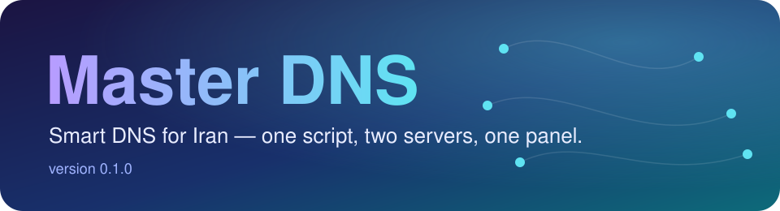
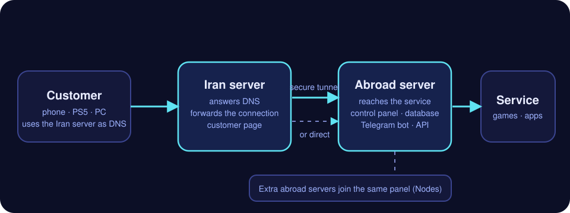

<div align="center">



**Smart DNS for Iran you can run — and sell — in an afternoon.**
One script. Two servers. One control panel.

*[فارسی](README.fa.md)*

</div>

---

## The idea in 30 seconds

People in Iran point their phone, PC or console at **your Iran server** as their DNS.
Blocked sites are answered with that server's address; the connection then travels,
untouched, to **your server abroad**, which reaches the service. Everything else
loads the normal way.

<p align="center"></p>

Nothing is decrypted on the way: the Iran server only reads which site is being asked
for and passes the connection on. And it is a whole service, not just a proxy — customers,
quotas, speed limits, a customer page, a control panel, selling, a Telegram bot and an API.

## What's new in 0.0.9

| | |
|---|---|
| 🔀 **Change the tunnel from the panel** | *Settings → "How the Iran server connects to the exit server"*: pick another connection style and both servers switch within a minute. No SSH. |
| 🗺️ **A map of your servers** | The *Nodes* page now shows every server as a card with its own **name**, health bars and a live line to the server it goes through. |
| 🧰 **A friendlier installer** | Plain words, one suggested answer for every question, a secure tunnel in one keypress, and a "what to do next" list at the end. |
| 🧭 **A tidier Settings page** | Four clear sections with quick links on top. |
| 🛡️ **Safer panel** | A content-security policy, a check that refuses requests coming from other websites, and stricter browser headers. |
| 🐞 **Fixed** | The menu behind a user's three dots had no background and was drawn under the next rows. |

## Quick start

```sh
curl -fsSLO https://raw.githubusercontent.com/AlsoAryan/Master-dns/main/master-dns.sh
sudo bash master-dns.sh
```

1. **On the server abroad**: run it and choose *Abroad server*. When it finishes it shows
   the control-panel link, your username and password, and a **connection code**.
2. **On the server in Iran**: run it, choose *Iran server*, and paste the connection code.
3. Give your customers the Iran server's IP address as their DNS. Manage everything from
   the control panel.

It downloads first instead of piping, on purpose: the configs live inside the script and it
asks questions. It refuses to run if the file is cut short.

| You choose | Where | What it does |
|---|---|---|
| **Abroad server** (`exit`) | a server abroad | the panel, the database, the way out. Install it first; it prints a connection code |
| **Iran server** (`relay`) | a server in Iran | answers DNS, serves the customer page. Paste the code when asked |
| **One server only** (`single`) | one server abroad | all of the above on one machine, `ROLE=single`. Good for trying it out |
| **Extra abroad server** (`node`) | another server abroad | one more way out, added from the panel's *Nodes* page |

The installer numbers and times each step and ends with a summary. `sudo bash master-dns.sh --check` first looks at the machine (system, systemd, memory, disk,
address, ports 53, 80 and 443) and changes nothing; an install ends with a timeline of where
the time went. It is safe
to re-run, backs up what it replaces, and `sudo bash master-dns.sh --uninstall`
puts the machine back, asking before it removes the database or packages.
`sudo smartdns-menu` lists every command afterwards.

Open in the firewall: **tcp** 22, 53, 80, 443, 853, 1119, 4070, 8443 and the
admin port (9443 by default, and never 8446, which the exit keeps for its own
route to Google over IPv6); **udp** 53, 3478.

## What is in it

- **Routing**: about 800 blocked domains, 150 games and platforms, AAAA
  filtering, STUN/TURN so console NAT checks pass.
- **Customers**: an allowlist on their address with kernel byte counters,
  monthly or one-off quotas with warnings at 80% and 95%, per-customer speed
  caps, service templates down to single domains.
- **Selling**: plans, receipts, discount codes, a free trial, a wallet,
  invitation links, extra devices, and resellers with their own plans and bot.
- **Panels**: a dashboard-style operator panel and a customer panel in Persian or
  English, light and dark, with a blue, pink, green, red, purple or orange accent. The admin panel opens a
  jump-to-page palette on Ctrl/Cmd+K or `/`; the customer panel is a wide dashboard on a
  computer and a single column on a phone. The public
  forms are guarded against bots and floods: a hidden trap field, a signed
  timer and a per-address limit, none of which a person notices.
- **Encrypted DNS**: DoH and DoT per server, an address per customer, an iPhone
  profile, a Windows 11 command. WireGuard for where DNS alone is not enough.
- **Scale**: more exits and single servers on one panel, a standby that takes
  over, monitoring alerts, encrypted backups, one-button upgrades.
- **Telegram bot** for customers and operators, set up from the admin panel.

## API

A sales bot of your own can plug into the panel: [docs/bot-api.md](docs/bot-api.md)
(Persian). To move one customer's days or traffic by hand, from an admin key:

```sh
curl -X POST https://PANEL/api/v1/admin/users/42/adjust \
  -H "Authorization: Bearer $KEY" -H "Content-Type: application/json" \
  -d '{"days": 7, "gb": -2}'
```

`days` and `gb` (or `bytes`) take a plus or a minus, together or alone. An
unlimited account is never made limited by it, and a quota is never taken to
zero, because zero means unlimited.

Two more for a sales bot: `POST /api/v1/admin/users/adjust` does the same for many
accounts at once (`{"all": "active", "days": 2}` after an outage; up to 500 per call,
the ones that cannot take it are named), and `GET /api/v1/admin/expiring?days=3&usage=90`
lists who is about to run out of days or traffic, soonest first, which is what a renewal
reminder is made from. `GET /api/v1/admin/users` now pages (`limit`, `offset`) and narrows
by `status`.

## Commands

On a server, `sudo smartdns-menu` lists everything; the ones used most:

```sh
smartdns status                  # what this machine is doing
smartdns list                    # every domain being routed
smartdns find spotify            # which ones match
smartdns add example.com         # route one more
smartdns del example.com         # stop routing it
smartdns test example.com        # what this relay answers for it
smartdns-rules show test         # the full lists for one template
smartdns-rules check gemini.google.com
smartdns-acl list                # everyone, with usage
smartdns-acl usage 5.188.44.19   # one address
smartdns-acl add 5.188.44.19 ali # register one by hand
smartdns-acl del 5.188.44.19
smartdns-acl reset <ip>|--all    # zero the counters
smartdns-acl enforce status      # open, or only registered addresses?
smartdns-acl enforce on          # close it
smartdns-acl enforce off         # open it to everyone
smartdns-acl save                # persist to disk now
smartdns-shape list              # what is in force
smartdns-shape off               # remove all shaping
smartdns-cert panel.example.com  # get or renew a certificate for that name
smartdns-access username ali     # change the owner's username
smartdns-access port 9443        # move the panel, if a firewall is in the way
smartdns-access path [new]       # change the secret path, or roll a fresh one
smartdns-access password [new]   # set a new one; the old is not recoverable
smartdns-access rotate           # new path and new password at once
```

## When a game will not start

A name that is not on port 443 cannot go through the relay, which carries only 80 and
443. Watch what the game asks for and take such names off the relay.

Run `sudo smartdns-watch` for the customer to see which names went via the relay and which
went direct, then make a name direct with `smartdns bypass` (the menu has both).

`smartdns-watch` ends a Call of Duty session by listing any Demonware web names that went
direct, for `smartdns add`. Call of Duty's update check needs four Demonware HTTPS names routed; they are in the
`cod-https` group, which the game asks for. A template made before that group existed gets
it once, at the panel's first start after the upgrade, if it routes any other Blizzard /
Activision group; unticking it afterwards sticks. PUBG Mobile's "Server is busy" with the code
`restrict-area` comes from its login (proximabeta.com on 8085/8086) seeing an Iranian
address, which DNS alone cannot change. War Thunder talks on ports such as 20443 and
8090; find the names with `smartdns-watch` and make them direct.

## Build and test

`master-dns.sh` is generated. The logic is in `tools/installer-logic.sh`, the
configs in `templates/`, `common/` and `domains/`.

```sh
python3 tools/build-installer.py   # rewrites master-dns.sh
bash -n master-dns.sh              # it stays valid bash
for t in tools/test-*.py; do python3 "$t"; done
```

## Kernel settings

The install writes `/etc/sysctl.d/99-smartdns-tuning.conf` (and, on request, BBR). Besides large
buffers for a long path, it caps unsent data per socket so a download cannot queue a game's login
behind it, and raises the connection-tracking table, whose overflow drops packets without a word.

## Known limits

- Only download is shaped, not upload.
- A relay without a certificate has no customer panel; it will not serve a
  password page over plain HTTP. Give it a domain.
- Sign-up alone gives no traffic; the account needs a plan.
- Traffic costs double: a customer's gigabyte is about two on the relay and two
  on the exit.

## Credits

- **[BackPack](https://github.com/AminMGMT/BackPack)**, by **Amin Mohammadi**
  ([@AminMGMT](https://github.com/AminMGMT)), carries the optional tunnel
  between the relay and the exit. It is his work, released under the AGPL-3.0:
  this project only downloads his own unmodified releases, checks them against
  a pinned hash, and runs them. Thank you, Amin.
- **[Vazirmatn](https://github.com/rastikerdar/vazirmatn)**, by **Saber Rastikerdar**,
  is the font of both panels. It is released under the SIL Open Font License 1.1
  and travels inside the installer with its licence. With thanks to him and the
  Vazirmatn project.
- **[Poppins](https://github.com/itfoundry/Poppins)**, by the Poppins Project Authors,
  sets the Latin letters and numerals in both panels; a small subset is embedded in
  the pages. It is released under the SIL Open Font License 1.1, and its licence is
  in `common/fonts/Poppins-OFL.txt`.
- The operator shown for each customer in the admin panel comes from
  [RIPEstat](https://stat.ripe.net/), RIPE NCC's public routing data.
- The services' logos on a template's page are from **[Simple Icons](https://simpleicons.org/)**
  (CC0), and the plain icons for rows that are no brand from **[Lucide](https://lucide.dev/)**
  (ISC). Each logo is its owner's trademark.
- **[HyperDNS](https://github.com/IzumiRain/HyperDNS)**, by **Rain**
  ([@IzumiRain](https://github.com/IzumiRain)), a standalone smart DNS written in Go
  and released under the AGPL-3.0. Reading it showed us what Doctor DNS was
  missing, and several features here began as its ideas: DNS over HTTPS and over
  TLS, with the customer usage dashboard and the choice of public resolvers planned
  beside them (0.7.0); the sealed, encrypted receipts (0.7.2); the DNS report that
  says which rule each name met (0.7.3); an answer that says the resolver failed,
  rather than silence (0.7.4); blocked domains and the single-server install (0.8.0);
  the services' logos, and groups of your own domains with an icon (0.9.10).
  Doctor DNS used none of its code - each was written here, in Python, for this
  design - but the ideas were theirs first. Thank you, Rain.
- The installer's check of whose name an exit's address is registered in asks the
  regional internet registries' public RDAP service, through [rdap.org](https://rdap.org/).
- The exit's nginx configuration started from
  [rohammosalli/smart-dns](https://github.com/rohammosalli/smart-dns).

## Licence

MIT, see [LICENSE](LICENSE). Master DNS is a fork of Doctor DNS, which is MIT
as well; its copyright notice stays in the licence file.
